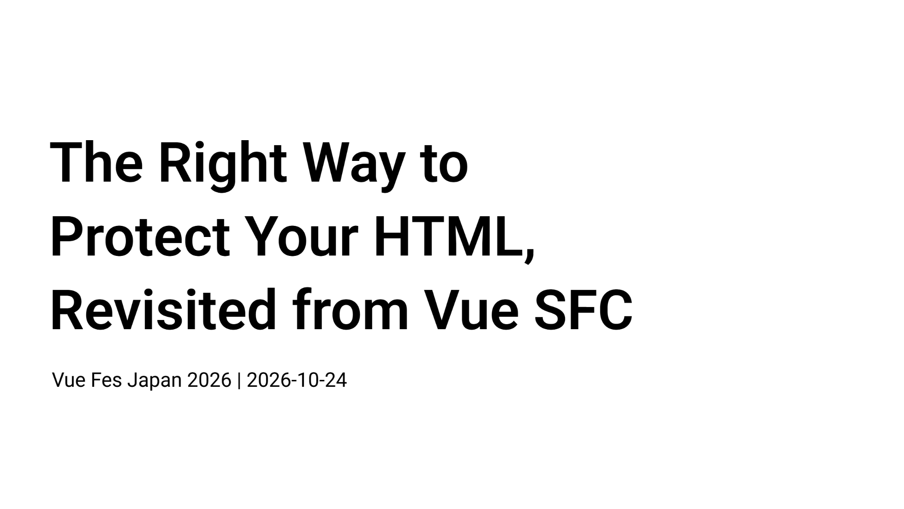
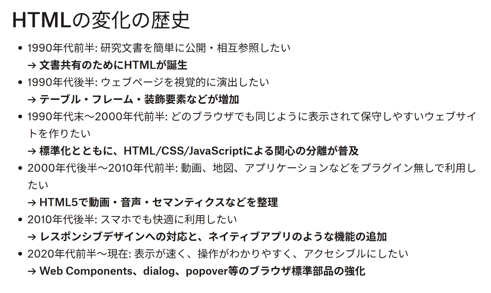

[日本語ページ](../ja/) / [English page](../en/)

## Slides

[Slide deck](https://records.yamanoku.net/vuefes-japan-2026/slide/)

---

## Introduction

Hello, everyone. I'm yamanoku.

I'm a parent of one child, and I worked as a company employee through this October. I'm also involved as core staff for Vue Fes Japan 2026. I organize HTML Night in Tokyo and HTML Day 2026 in Tokatsu as well.

At Vue Fes Japan 2025, I gave a talk on [Improving Web Application Accessibility in the Generative AI Era](https://records.yamanoku.net/vuefes-japan-2025/en/). I also run [Vue Fes Japan Speakers](https://vuefes-japan-speakers.yamanoku.net/), a personal site that lists past speakers. Looking myself up there, I've spoken six times over four years, including panel discussions. I'm grateful for another chance to speak.

This time, as the title says, the theme is HTML.

HTML appeared in 1991 and turns 35 this year. It spread as markup for documents, then evolved into decorative pages and Web app UI. Because it can express more than Markdown, it is also used in AI output. The specification continues to be updated as the [HTML Living Standard](https://html.spec.whatwg.org/).

<figure>



<figcaption>Source: <a href="https://www.dropbox.com/scl/fi/4al6p7za54z9k3zidqps7/HTML.paper?rlkey=mo5qbfgq60pct57l743jqtksa&dl=0">HTMLという地層の堆積</a> / yuhei</figcaption>
</figure>

Early on it described document structure—headings, paragraphs, links. Midway came forms and interaction. Today, even with SPA / SSR / design systems, the final output is often HTML. Even when you write Vue templates, what the browser receives is HTML. Understanding the specification is shared ground that comes before any framework.

And in Vue, HTML is also used as a DSL.

```html
<script setup>
  import { ref } from "vue";
  const count = ref(2026);
  const addYear = () => {
    count.value++;
  };
</script>

<template>
  <h1>Vue Fes Japan {{count}} へようこそ！</h1>
  <button type="button" class="btn" @click="addYear">+1</button>
</template>
```

Let me ask a direct question. When you develop with Vue, can you explain how you protect and verify HTML “correctness”?

Through today's talk, you can learn how to write HTML correctly and keep it that way. I'll focus on three themes:

1. What HTML correctness means
2. How Vue uses HTML
3. Protecting HTML correctness with static analysis

---

## What is “correct HTML”?

Before the main topic, I want to align on what “correct HTML” means.

Suppose we mark up a short blurb like this:

> “Japan's largest frontend conference, Vue Fes Japan”

The requirements are: put it in a paragraph; emphasize “Japan's largest frontend conference”; and make “Japan's largest” the strongest emphasis.

Written as intended, it might look like this:

```html
<p>
  <em><strong>日本最大級の</strong>フロントエンドカンファレンス</em> Vue Fes Japan
</p>
```

The DOM the browser builds keeps that intended nesting.

<figure>


<figcaption>Intended nesting appears as-is in the DOM</figcaption>
</figure>

What happens if the closing tags are mismatched?

```html
<p>
  <em><strong>日本最大級の</em>フロントエンドカンファレンス</strong> Vue Fes Japan
</p>
```

The browser does not stop on an error; it reparses with its own recovery. The resulting HTML can differ from what you first expected.

<figure>


<figcaption>The page may still render, but the HTML can diverge from intent</figcaption>
</figure>

Even with syntax errors, HTML is parsed through browser self-interpretation. The specification does not treat “it displays” as “it conforms”; it catalogs the mistakes. Problems can still show up in structure, styling, SSR, and accessibility.

There is no single “correct” markup for every case. Instead, HTML has rules you must follow. Getting it to parse correctly is one of them. In this talk, “HTML correctness” means thoroughly following those rules.

Correct HTML brings benefits such as:

- More robust, maintainable code
- Content that both people and user agents can handle
- Accessibility you can protect
- Hydration mismatches you can catch earlier

Concrete mistakes fall into three kinds of rules:

1. **Lexical rules**
2. **Vocabulary rules**
3. **Semantic rules**

Let's look at them in order.

### Lexical rules

Matching start and end tags, and how attributes are written. Violations make the parser error and prevent a correct DOM tree. In HTML syntax, though, recovery can make things still “work” on screen.

```html
<!-- NG: mismatched end tags / broken attribute value quoting -->
<div>
  <p>text
</div>
```

WHATWG explains why such syntax is non-conforming in [Syntax errors](https://html.spec.whatwg.org/dev/introduction.html#syntax-errors): bad syntax yields counter-intuitive DOMs, works poorly with streaming, and confuses authors about the specification. Because the spec names reasons to stop these cases, the checkers we cover later can ask the same questions mechanically.

### Vocabulary rules

Which elements and attributes you may use, and nesting rules from the **content model**. Violations do not stop the parser; they produce undesirable DOMs. The specification organizes this under [Restrictions on content models and on attribute values](https://html.spec.whatwg.org/dev/introduction.html#restrictions-on-content-models-and-on-attribute-values). Even when tags match, wrong nesting can silently produce a broken DOM.

```html
<!-- NG: block elements must not appear inside p -->
<p>
  <div>block</div>
</p>
```

### Content models

The content model is the core of vocabulary rules: what may appear inside which element. The specification groups elements into zero or more categories under [Kinds of content](https://html.spec.whatwg.org/multipage/dom.html#kinds-of-content):

- Metadata content
- Flow content
- Sectioning content
- Heading content
- Phrasing content
- Embedded content
- Interactive content

Sectioning, heading, phrasing, embedded, and interactive content are all types of flow content. Metadata is sometimes flow content. Interactive is sometimes phrasing. Embedded is a type of phrasing and is sometimes interactive.

For example, `p`'s content model is phrasing content, so a flow-only element like `div` is not allowed. Nesting rules such as “children of `ul` are basically `li`” also come from combining these categories with each element's content model.

| Parent | Child elements | Why it's NG |
| --- | --- | --- |
| `p` | `div`, `p`, `ul` | Blocks cannot go inside a paragraph |
| `label` | `div`, `p` | Outside the label content model |
| `a` | `a` | Nested links are not allowed |
| `ul` / `ol` | `div` | Children should basically be `li` |

Vue nesting warnings and linters mainly fire on these vocabulary rules. I want you to keep in mind that “looks the same” can still mean “different DOM meaning.” We can verify vocabulary rules mechanically because the specification defines these categories.

### Semantic rules

This is the part often called “semantics.” Using an element for a purpose other than what it is for is a violation. Markup can be grammatically fine and still communicate the wrong meaning. That matters for accessibility.

```html
<!-- NG: using a heading only for appearance -->
<h1 class="title-like">I just want bigger text</h1>

<!-- NG: building a button with an a -->
<a href="#" onclick="submitForm()">Submit</a>
```

Tools cannot catch everything; review and experience still matter. Semantics connect directly to accessibility, one of HTML's strengths.

That wraps part one. Even as use cases spread from documents to sites to apps, the final deliverable is still HTML—and “it works” is not the same as “it is correct.” Split correctness into lexical / vocabulary / semantic rules, then revisit HTML correctness in Vue on that foundation.

---

## How Vue uses HTML

From here, we'll see how Vue handles this HTML and how far it guarantees it. Up front: Vue parses HTML, but it does not guarantee the same final DOM as the browser.

Again, Vue uses HTML as a DSL. It looks like HTML, but it is transformed into functions that produce a virtual DOM.

Vue SFC compilation has three stages:

1. **Parse** — build an AST with HTML-flavored lexical rules (void elements, namespaces, entity references, and so on)
2. **Transform** — apply Vue directives and optimizations to the AST
3. **Generate** — finally emit JavaScript

At Parse time, broken HTML writing can be detected and reported as errors. That is the lexical-rule coverage. The output, though, is not an HTML string for the browser; it is JavaScript that builds a virtual DOM. The template looks like HTML, but the product is “a program that assembles the DOM.”

### Can `<div />` be parsed?

Quiz time. Can `<div />` be parsed?

The answer: yes. In Vue it is interpreted as `<div></div>`.

- `<div v-text="Vue Fes Japan" />` renders as `<div>Vue Fes Japan</div>`
- `<div />Vue Fes Japan` becomes `<div></div>Vue Fes Japan`
- Custom Elements and Vue components can also use self-closing tags
- Detection uses whether `isSelfClosing` is present on the AST

But as HTML, `<div />` is not valid. That is one example of the gap between Vue's parsing and HTML conformance.

A short digression on self-closing tags: Prettier always emits closing tags. Biome lets you change the behavior (`--html-formatter-self-close-void-elements=<always|never>`). In Svelte, Rich Harris revisited the topic and a migration tool was created (`npx svelte-migrate self-closing-tags`). Conventions differ by framework—worth remembering.

### Content models get warnings

So does Vue do nothing? Not quite. From Vue 3.4 onward, `compiler-dom`'s `validateHtmlNesting` warns about invalid nesting in development.

<figure>


<figcaption>Example of a development-time nesting warning. Welcome DX—but ignore it and things still run</figcaption>
</figure>

It is welcome DX aimed partly at preventing SSR hydration mismatches, but it is still only a **development-time warning**, not a hard compile error. Ignore the warning and it still runs.

So Vue's compiler coverage looks like this:

| Rule | Vue compiler coverage |
| --- | --- |
| Lexical | 〇 |
| Vocabulary | △ (development-time warnings only) |
| Semantic | ✕ |

Vocabulary and semantic rules need static analysis.

---

## Protecting HTML correctness with static analysis

Why do we need static analysis? One reason is to give AI agents deterministic judgments.

Judgment by AI alone is non-deterministic. Even capable models depend on the model, so certainty is thin. Having them analyze structural correctness, type safety, and internal consistency—and ideally doing that analysis quickly—matches how many teams feel today.

From here, we'll look at what each lint tool is for and which areas it protects.

### ESLint

The foundation that spread first is ESLint plus [eslint-plugin-vue](https://eslint.vuejs.org/).

[`vue/no-parsing-error`](https://eslint.vuejs.org/rules/no-parsing-error.html) can report syntax errors inside `<template>`. It catches many **lexical** WHATWG HTML syntax errors and is included in essential-style presets. Checks specific to self-closing tags alone are disabled by default. I have not found rules that fully cover vocabulary rules; on the semantic side, something like [`vue/html-button-has-type`](https://eslint.vuejs.org/rules/html-button-has-type.html) applies.

[eslint-plugin-vuejs-accessibility](https://vue-a11y.github.io/eslint-plugin-vuejs-accessibility/) protects semantics through an accessibility lens. For example, [`form-control-has-label`](https://vue-a11y.github.io/eslint-plugin-vuejs-accessibility/rules/form-control-has-label.html) lets you name label and control components.

```json
{
  "rules": {
    "vuejs-accessibility/form-control-has-label": [
      "error",
      {
        "labelComponents": ["CustomLabel"],
        "controlComponents": ["CustomInput"]
      }
    ]
  }
}
```

There is also [html-eslint](https://html-eslint.org/) for HTML linting with ESLint. It supports React / Svelte / Angular, but Vue is not supported yet.

### Biome

[Biome](https://biomejs.dev/) is an all-in tool that combines linter and formatter. It supports many languages and libraries, including Vue.

[`noDuplicateAttributes`](https://biomejs.dev/linter/rules/no-duplicate-attributes/) stops duplicate attributes. HTML-oriented rules such as [`noObsoleteTags`](https://biomejs.dev/linter/rules/no-obsolete-tags/) and [`noMisplacedListElements`](https://biomejs.dev/linter/rules/no-misplaced-list-elements/) are growing. Semantic-leaning help such as [`useSemanticElements`](https://biomejs.dev/linter/rules/use-semantic-elements/) is available too.

Biome is also advancing [HTML super languages support](https://biomejs.dev/introduction/language-support/#html-super-languages-support). From v2.3.0, Vue / Svelte / Astro work out of the box for formatting and linting HTML / CSS / JavaScript inside those files. Full support is still experimental, so you likely need to enable it explicitly.

### Oxc

[OxLint](https://oxc.rs/) is a linter; for Vue it mainly checks Vue-specific rules. There is currently no mechanism to check inside `<template>`. If [RFC: Embedded Framework Support for Oxlint (Language Plugins)](https://github.com/oxc-project/oxc/discussions/21936) moves forward, support may become clearer. Following it as a speed-oriented complement is enough for now.

### Markuplint

ESLint and Biome / Oxc mainly cover lexical and syntax-oriented defense. The layer that checks content models and conformance against HTML specification data in depth was thin. [Markuplint](https://markuplint.dev/) fills that gap.

Markuplint's strength is **conformance checking** based on the Living Standard. `@markuplint/vue-parser` / `@markuplint/vue-spec` handle `.vue` files.

[`parse-error`](https://markuplint.dev/docs/configuration/parser-options) can detect non-fatal parse errors during tokenization and tree construction in the HTML Living Standard.

```json
{
  "parserOptions": {
    "parseError": {
      "duplicate-attribute": "error",
      "nested-comment": "warning"
    }
  }
}
```

[`permitted-contents`](https://markuplint.dev/docs/rules/permitted-contents) validates content models from specification data.

```html
<!-- incorrect -->
<ul>
  <div>Not allowed DIV element</div>
</ul>

<!-- correct -->
<ul>
  <li>List item</li>
  <li>List item</li>
</ul>
```

Beyond conformance, there are semantic-leaning rules that help in practice.

[`no-pseudo-list`](https://markuplint.dev/docs/rules/no-pseudo-list) stops bullet characters used as fake lists and asks for `ul` / `li`.

```html
<!-- incorrect -->
<div>
  •Apple<br />
  •Banana
</div>

<!-- correct -->
<ul>
  <li>Apple</li>
  <li>Banana</li>
</ul>
```

[`no-consecutive-br`](https://markuplint.dev/docs/rules/no-consecutive-br) warns on consecutive `<br>`. Prefer paragraphs or spacing styles instead of stacking line breaks for whitespace.

```html
<!-- incorrect -->
<p>
  A...<br />
  <br />
  B...
</p>

<!-- correct -->
<p>A...</p>
<p>B...</p>
```

[`no-skipped-heading-level`](https://markuplint.dev/docs/rules/no-skipped-heading-level) warns when heading levels are skipped.

```html
<!-- incorrect -->
<h1>Heading 1</h1>
<h3>Heading 3</h3>
<h2>Heading 2</h2>

<!-- correct -->
<h1>Heading 1</h1>
<h2>Heading 2</h2>
<h3>Heading 3</h3>
```

There is also [Pretenders](https://markuplint.dev/docs/guides/besides-html): an option to treat components as the **HTML elements** they render. For example, map `FileList` → `ul` and `FileListItem` → `li` to evaluate content models. From v5, experimental auto-scan is also available.

```json
{
  "pretenders": {
    "scan": [
      {
        "files": "./src/components/**/*.vue"
      }
    ]
  }
}
```

At this point we have two layers: stop lexical issues, and check conformance against the specification.

### Vize

Further along that line is [Vize](https://vizejs.dev/), a Rust-based Vue toolchain by ubugeeei. It separates HTML conformance from Vue-specific rules and accessibility.

- Vue: https://vizejs.dev/rules/vue/index.html
- HTML: https://vizejs.dev/rules/html/index.html
- a11y: https://vizejs.dev/rules/accessibility/index.html

Especially important is `html/cross-component-nesting`. Nesting that is legal in a single file but breaks after component composition can be stopped across files. `vize lint --cross-file` enables cross-file checks.

```html
<!-- App.vue -->
<template>
  <p>Summary <InfoCard /></p>
</template>

<!-- InfoCard.vue -->
<template>
  <div class="card"><slot /></div>
</template>
```

Each file alone is fine, but the composed result is effectively `<p><div>…</div></p>` and invalid. Pushing “correctness after composition”—hard to see with ESLint or Markuplint—is the current advance.

There is also `templateSyntax`. The compiler side can warn when self-closing tags appear, and you can switch modes to error or ignore.

```js
import vize from "@vizejs/vite-plugin";

export default {
  plugins: [
    vize({
      templateSyntax: "standard",
    }),
  ],
};
```

---

## Closing

To sum up: to face correct HTML in Vue, please take these three points home.

1. Understand the rules that keep HTML correct
2. Understand the Vue compiler's coverage
3. Guarantee HTML correctness with static analysis

In practice: hold syntax with eslint-plugin-vue, check specification-based conformance with Markuplint, and reinforce cross-file cases with Vize. Also watch Biome / Oxc progress and design who checks what. Looking only at SFC templates is not enough.

The HTML specification is still being updated. Keep the premise that the final deliverable is HTML even as use cases expand. Understand Vue's compilation, raise static analysis as a seawall, and let's build robust markup and accessible output together.

That concludes the talk. Thank you for listening.

## References

- [HTML Standard](https://html.spec.whatwg.org/)
- [HTML Standard — Kinds of content](https://html.spec.whatwg.org/multipage/dom.html#kinds-of-content)
- [WHATWG: Non-conforming features](https://html.spec.whatwg.org/#non-conforming-features)
- [HTMLという地層の堆積](https://www.dropbox.com/scl/fi/4al6p7za54z9k3zidqps7/HTML.paper?rlkey=mo5qbfgq60pct57l743jqtksa&dl=0) / yuhei
- [Vue: validateHtmlNesting](https://github.com/vuejs/core/blob/main/packages/compiler-dom/src/transforms/validateHtmlNesting.ts)
- [eslint-plugin-vue](https://eslint.vuejs.org/rules/)
- [eslint-plugin-vuejs-accessibility](https://vue-a11y.github.io/eslint-plugin-vuejs-accessibility/)
- [Markuplint](https://markuplint.dev/)
- [Vize HTML Rules](https://vizejs.dev/rules/html/index.html)
- [Oxlint & Oxfmt Compatibility | The JavaScript Oxidation Compiler](https://oxc.rs/compatibility)
- [RFC: Embedded Framework Support for Oxlint](https://github.com/oxc-project/oxc/discussions/21936)
- [弁護士ドットコム 新卒研修2025 HTML/CSS（太田良典）](https://speakerdeck.com/bengo4com/20250405-bengo4com-htmlcss)
