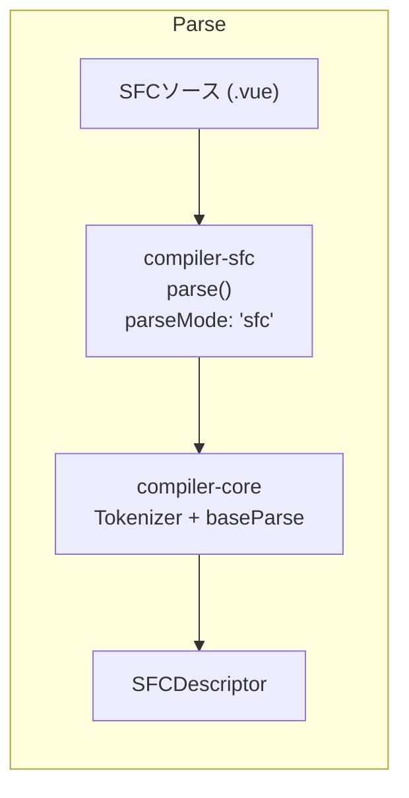
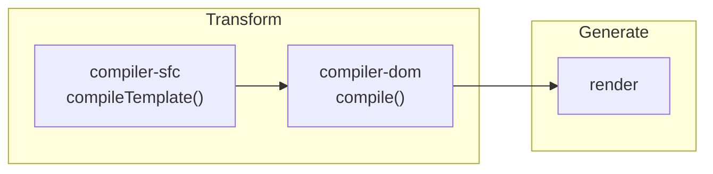

[日本語ページ](../ja/) / [English page](../en/)

## スライド

[スライド版ページ](https://records.yamanoku.net/vuefes-japan-2026/slide/)

---

## はじめに

みなさま、こんにちは。やまのくと申します。

昨年のVue Fes Japan 2025では[生成AI時代のWebアプリケーションアクセシビリティ改善](https://records.yamanoku.net/vuefes-japan-2025/ja/)という発表をさせていただきました。

[Vue Fes Japan Speakers](https://vuefes-japan-speakers.yamanoku.net/)という歴代の登壇者まとめページも個人で運営しており、自分を確認してみると四年も登壇させてもらっていました。改めて登壇の機会をいただけてありがたい限りです。

今回は発表タイトルにもあるように「HTML」を取り扱ったテーマで発表させていただきます。

いきなりですが質問です。皆さんはVueを使った開発をするとき、「HTMLの正しさ」をどのように守れているか・検証できているか、答えられるでしょうか？

Vue Fes Japanに参加されている皆さまにとっては周知の事実かと思いますが、VueのSFCには `<template>` でHTMLを書ける構文があります。

今日持ち帰ってほしいことはこれです。Vueのネスト警告は警告止まりで保証ではなく、コンパイラだけでは足りない隙間を、Linterでの静的解析で埋める、ということです。

本日は、コンパイラが `<template>` のHTMLをどう解釈しているかを仕組みから紐解き、その隙間を静的解析でどう守れるかを紹介します。

## HTMLとは何か、用途はどう広がったか

本題のVueに入る前に、なぜ今HTMLの話をするかを簡単に説明します。

Vueの最終成果物はJavaScriptとして吐き出され、画面上ではHTMLとCSS、JavaScriptによって描画されます。この時に出力されるHTMLは画面上で動作したとしても、それ自体がマークアップが正しいということだと言い切れません。だからあとで、Vueのコンパイラがどこまで保証しどこで隙間が残るかに戻ります。その前提を共有するために、いま現場が触っているHTMLとは何か／用途がどう広がったかを、先に再認識しておきます。

### いま現場が触っているHTML

いまのHTMLの仕様は [HTML Living Standard](https://html.spec.whatwg.org/) です。HTML4やHTML5というバージョン名で区切る時代もありましたが、継続更新されるLiving Standardとなっています。

HTML5以降の大きな資産は、SGMLに頼らず[パース規則そのものを仕様として定義し直した](https://html.spec.whatwg.org/multipage/parsing.html)ことです。閉じタグの省略可否やタグごとのアルゴリズムまで明示され、曖昧さが減りました。パースが仕様として書かれているからこそ、後述するLinterは「正しさ」を機械的に問えるようになります。

Living Standardでは、要素や属性の扱いが実装状況に合わせて更新され得ます。「昔からの慣習」が今の仕様では非推奨・非適合なこともあり、[Non-conforming features](https://html.spec.whatwg.org/#non-conforming-features) も明示されています。

### 用途の広がり——最終出力はいまもHTML

HTMLは一般公開から今年で35周年になります。文書のための言語として始まり、サイトへ、アプリへと用途は広がりました。フレームワークやビルドが挟まっても、ブラウザに届く最終成果物はHTMLです。

ひとつめは、初期HTMLのおおらかさです。SGMLの応用として、文脈から分かるなら閉じタグを省略でき、属性のショートハンドも認められました。パーサは例外ケースだらけになり、レンダリングエンジンごとの差も生まれました。いまも「壊れても補正して表示する」方向が残っています。

ふたつめは、XHTMLという厳格化の試みです。2000年頃、全タグを閉じる・属性値は引用符で囲む、といったXMLベースのルールで「厳格に書いて止める」方向が目指されました。しかし既存のWebの置き換えには至りませんでした。いちばん大きかったのは、いまでは鉄則とも言える**後方互換性**を軽く見ていたことです。ブラウザ実装側は互換性維持を選び、HTMLは「補正して動く」側で一本化されていきます。

みっつめは、その結果としての錯覚です。誤りがあっても画面は動いて見えやすい。利用者には良いことですが、開発者にとっては「動いている＝正しい」と錯覚しやすい土壌でもあります。

たとえば `p` の中に `div` を置くと、パーサが補正し、実際のDOMは意図と違う形になり得ます。HTML構文はエラーでも最後までパースするため、画面は出ても構造・スタイル・アクセシビリティに副作用が出ます。仕様も、表示できることと適合していることを同一視せず、誤りを [Syntax errors](https://html.spec.whatwg.org/dev/introduction.html#syntax-errors) や [内容モデル・属性値の制限](https://html.spec.whatwg.org/dev/introduction.html#restrictions-on-content-models-and-on-attribute-values) として整理しています。

マークアップに唯一の正解はありません。それでも品質の良し悪しと、明確な誤りはあります。「良いHTML」の条件としては、セマンティックであること、アクセシブルであること、誤りがないこと、保守しやすいことなどが挙げられます。まずは誤りをなくすことがスタート地点です。

具体的なHTMLの誤りは、次の3つのルールに分類できます。

### 字句的ルール

タグの閉じ方、属性の書き方などです。違反するとパーサがエラーを出し、DOMツリーが正しく作れません。ただしHTML構文では補正されて「動いて」見えることがあります。

```html
<!-- NG: 終了タグが対応していない -->
<div><p>テキスト</div></p>
```

開始タグと終了タグの対応が崩れていたり、属性値のクオートが欠けていたりする例です。XHTML／XMLなら即座に止まりますが、HTML構文では補正されて気づきにくいことがあります。一方で、閉じタグを省略しない・属性値を引用符で囲む、といったXHTML由来の慣例は、字句エラーを未然に減らす実践としても今も効いています。

WHATWGは、こうした構文をなぜ非適合にするかを [Syntax errors](https://html.spec.whatwg.org/dev/introduction.html#syntax-errors) で説明しています。不正な構文が直感に反するDOMを生む、ストリーミングと相性が悪い、著者が仕様を誤解しやすい、といった理由です。仕様が「止める理由」を言語化しているので、後述するチェッカーも機械的に問えるようになります。

### 語彙的ルール

使える要素・属性と、**内容モデル（content model）** による入れ子ルールです。違反してもパーサは止まらず、望ましくないDOMになります。仕様側では [Restrictions on content models and on attribute values](https://html.spec.whatwg.org/dev/introduction.html#restrictions-on-content-models-and-on-attribute-values) として整理されています。

```html
<!-- NG: p の中にブロック要素は置けない -->
<p>
  <div>block</div>
</p>

<!-- NG: リンクの入れ子は不可 -->
<a href="/a">
  外側
  <a href="/b">内側</a>
</a>

<!-- NG: ul / ol の直接の子は li -->
<ul>
  <div>item</div>
</ul>
```

タグの対応は合っていても、要素の入れ子が誤っていると静かに壊れたDOMができます。

### コンテンツモデル

内容モデルは「どの要素の中に何を置けるか」を決める語彙的ルールの中核です。仕様では [Kinds of content](https://html.spec.whatwg.org/multipage/dom.html#kinds-of-content) として、各要素をゼロ以上のカテゴリに分けています。

- Metadata content
- Flow content
- Sectioning content
- Heading content
- Phrasing content
- Embedded content
- Interactive content

これらの関係は次のとおりです。Sectioning・Heading・Phrasing・Embedded・Interactive はいずれも Flow の一種です。Metadata はときおり Flow、Metadata と Interactive はときおり Phrasing、Embedded は Phrasing の一種でもあり、ときおり Interactive でもあります。

仕様ではこの包含関係をベン図（[content-venn.svg](https://html.spec.whatwg.org/images/content-venn.svg)）で示しています。たとえば `p` の内容モデルは Phrasing content なので、`div` のような Flow 専用の要素は入れられません。`ul` の子は基本的に `li`、といった入れ子ルールも、このカテゴリと各要素の content model の組み合わせから決まります。語彙的ルールを機械的に検証できるのは、仕様がこうしたカテゴリを定義しているからです。

### 意味論的ルール

要素の意味と使い方、アクセシビリティです。文法として正しくても伝わる意味が違うことがあります。

```html
<!-- NG: 見た目のためだけに見出しを使う -->
<h1 class="title-like">ただ大きい文字にしたいだけ</h1>

<!-- NG: ボタンを a で作る -->
<a href="#" onclick="submitForm()">送信</a>
```

ツールだけでは完全には検出できず、レビューと経験が必要です。意味論は、HTMLの強みであるアクセシビリティに直結します。

第1部のまとめです。用途は文書からサイト、アプリへと広がっても、最終成果物はHTMLであり、「動く」ことと「正しい」ことは一致しない。正しさは字句 / 語彙 / 意味論で切り分け、その土台の上でVueにおけるHTMLの正しさを見直していきます。

## VueでHTMLはどのように使われているのか

結論を先に言うと、VueはHTMLをパースしますが、それ自体がブラウザで表示されるHTMLの正しさを保証してくれているわけではありません。

文脈として、フレームワークごとの扱いは次のように分かれます。以降はVueに絞ります。

| 系統 | 例 | 扱い |
| --- | --- | --- |
| HTMLをDSLとして使う | Vue / Svelte / Ripple | template等で宣言的UI |
| JSXでHTML風に書く | React / SolidJS / Preact | JSの中の式（閉じタグ必須などXML寄りの慣習） |
| HTMLファースト | Alpine.js / htmx | HTMLを起点に振る舞いを足す |

Vueの本線はtemplateとしてのDSLで、HTML・CSS・JavaScriptをそれぞれのブロックで切り分けて書けます。見た目はHTMLですが、最終的には仮想DOM生成の関数へと変換されます。

Vue SFCのコンパイルは次の3段階に分けられます。

1. **Parse** — HTML文字列 → AST
2. **Transform** — AST の変換
3. **Generate** — AST → JSコード文字列

<figure>





<figcaption>SFCソースが Parse → Transform → Generate を経て render 関数コードになる流れ</figcaption>
</figure>

`compiler-sfc` はファイルを `parse()` で `SFCDescriptor` に分解し、`compileScript` と `compileTemplate` がそれぞれ `<script>` / `<template>` を処理します。

コンパイラはHTMLを次のように解釈します。

- **Parse時**: void要素・名前空間・実体参照など、HTML寄りの字句ルールでASTを作る
- **Transform時**: Vueディレクティブや最適化をASTに適用する
- **Generate時**: 最終成果物はブラウザ向けHTML文字列ではなく、仮想DOMを作るJavaScriptに変換

つまりtemplateの見た目はHTMLでも、出力は「DOMを組み立てるプログラム」です。冒頭で固定した通り、ここが今日の本題の分岐点です。

たとえば次のような不正なネストがあっても、コンパイル後は「関数呼び出し」として成立し得ます。

```html
<template>
  <p>
    <div>block</div>
  </p>
</template>
```

仮想DOM生成では要素をプログラム的に作るため、ブラウザのHTMLパーサが行うような再配置が起きないからです。

ではVueは何もしないのかというと、そうではありません。Vue 3.4以降、`compiler-dom` の `validateHtmlNesting` により、不正なネストが開発時に警告されます。

<figure>


<figcaption>開発時のネスト警告の例。ありがたいDXだが、警告を無視すればそのまま動いてしまう</figcaption>
</figure>

> `<h1>` cannot be child of `<p>`, according to HTML specifications. This can cause hydration errors or potentially disrupt future functionality.

これは `onWarn` による**開発時の警告**であり、明確なコンパイルエラーではありません。ありがたいDXですが、警告を無視すればそのまま動いてしまいます。

Vueコンパイラが見る範囲は次のとおりです。

| ルール | Vueコンパイラ |
| --- | --- |
| 字句的 | △〜○（パースできる範囲） |
| 語彙的（内容モデル） | 一部を開発時警告 |
| 意味論的 | ✕ |

つまり、Vue自身はHTMLの正しさを完全には保証してくれません。コンパイラだけでは守れない隙間もあります。

| レイヤー | 例 | 限界 |
| --- | --- | --- |
| 実行時 | ハイドレーションミスマッチ警告 | 正しさの保証ではない |
| 型 | TypeScript（`HTMLElement` など） | DOM APIの型であり適合性ではない |
| 成果物 | 出力HTMLの静的解析 | ビルド後にしか見えない |

<!-- ### 補足・別のモード

#### Vapor Mode
VDOMモードでは不正ネストも「動いて」きた歴史がありますが、Vapor は `innerHTML` ベースのテンプレート生成に寄り、ブラウザのHTMLパーサの修復がそのまま効きます。不正ネストがコンパイル結果と実DOMの不一致・実行時クラッシュにつながり得ます（例: [vuejs/core#15256](https://github.com/vuejs/core/issues/15256)）。

#### Pug
`eslint-plugin-vue` だけでは効かない場合があり、コミュニティ製プラグイン（例: `eslint-plugin-vue-pug`）が必要になります。

#### Vue JSX
VueでもJSXでUIを書けます。Virtual DOM / Vapor Mode に対応し、Oxcベースの高速コンパイラをうたうプロジェクトです。見た目はHTMLでも本質は **JS式 → レンダー関数** であり、SFCの `<template>` とは検証経路が異なります。`validateHtmlNesting` や `eslint-plugin-vue` の守備範囲は主に `<template>` 向けなので、JSXを使う場合は別途、誰がHTMLの正しさを見るかを設計する必要があります。ネスト検証の一例として [`eslint-plugin-validate-jsx-nesting`](https://github.com/MananTank/eslint-plugin-validate-jsx-nesting) があります。 -->

## VueでHTMLの正しさを検証するためのツール紹介

ここまで見てきた通り、Vueのテンプレートはコンパイラや実行時のVue自身はHTMLセマンティクスを明確に制御・検証しきれていません。不正なネストでも関数としては通ってしまうことがあります。そのため最終的な出力結果としてブラウザが意図せぬDOM修正を起こす前に、静的解析によってその問題を埋めていくことが必要になります。

ここでは各Lintツールがそれぞれが何の役割をもっているか、どの領域を明確に守っているのかについてを見ていきます。

### ESLint

最初に広まった土台は、ESLint と [eslint-plugin-vue](https://eslint.vuejs.org/) です。長所は、template の字句エラーを日常の開発フローに乗せられることです。[`vue/no-parsing-error`](https://eslint.vuejs.org/rules/no-parsing-error.html) は WHATWG HTML の字句的な構文エラーを多く検知でき、essential 系プリセットにも含まれます。第1部で触れた [Syntax errors](https://html.spec.whatwg.org/dev/introduction.html#syntax-errors) ——タグの対応崩れや属性の書き方崩れなど——を、エディタ連携とCIで早期に止められます。

補足として、字句以外にも HTML の「使い方」に触れるルールはあります。[`vue/html-button-has-type`](https://eslint.vuejs.org/rules/html-button-has-type.html) は `<button>` に明示的な `type` を求め、[`vue/no-template-target-blank`](https://eslint.vuejs.org/rules/no-template-target-blank.html) は `target="_blank"` に `rel="noopener noreferrer"` を求め、[`vue/no-restricted-html-elements`](https://eslint.vuejs.org/rules/no-restricted-html-elements.html) で特定要素を止められます。

ちなみにESLintには明確にHTMLチェックする用途として[html-eslint](https://html-eslint.org/)というのもあります。しかし現時点においてはVueのサポートが入っていないため恩恵を得られない状態になっています。

### Markuplint

ESLint、Biome / OxCが得意なのは主に字句・構文寄りの守備です。内容モデルや仕様適合性までを、HTML仕様データとして厚く見る層は足りていませんでした。その隙間を埋めるように存在しているのが Markuplint です。

Markuplintの長所は、Living Standard ベースの**適合性検証**ができることです。

[`permitted-contents`](https://markuplint.dev/docs/rules/permitted-contents) で内容モデルを仕様データから検証でき、[`no-obsolete-element`](https://markuplint.dev/docs/rules/no-obsolete-element) で廃止要素を止め、[`require-accessible-name`](https://markuplint.dev/docs/rules/require-accessible-name) でアクセシブルネームも見られます。`@markuplint/vue-parser` と `@markuplint/vue-spec` でVueファイルを扱えます。

適合性だけでなく、現場で効く特徴的なルールもあります。いくつか紹介します。

[`no-pseudo-list`](https://markuplint.dev/ja/docs/rules/no-pseudo-list) は、ビュレット文字で箇条書きを擬似している箇所を止め、`ul` / `li` を使うよう求めます。見た目だけのリストは、スクリーンリーダーにリストとして伝わりません。

```html
<!-- NG: ビュレット文字で擬似リスト -->
<div>
  • Apple<br />
  • Banana<br />
  • Citrus
</div>
```

[`no-consecutive-br`](https://markuplint.dev/ja/docs/rules/no-consecutive-br) は、連続する `<br>` に警告します。改行の重ね打ちで余白を作る代わりに、段落や余白用のスタイルへ寄せましょう。`--fix` による自動修正にも対応しています。

```html
<!-- NG: 連続 br で余白を作っている -->
<p>
  A...<br />
  <br />
  B...
</p>
```

[`no-skipped-heading-level`](https://markuplint.dev/ja/docs/rules/no-skipped-heading-level) は、見出しレベルを飛ばすと警告します。HTML Living Standard の見出しとアウトラインの要件に沿い、`h1` の次に突然 `h3` が出るような見出しジャンプをチェックします。

```html
<!-- NG: h1 の次が h3 -->
<h1>見出し1</h1>
<h3>見出し3</h3>
<h2>見出し2</h2>
```

[`no-broken-fragment-link`](https://markuplint.dev/ja/docs/rules/no-broken-fragment-link) は、`#id` のようなフラグメントリンクが、同じドキュメント内の実在する ID を指しているかを見ます。仕様上は参照先がなくても適合性違反にはなりませんが、リンクが何もしないまま残るのは実害です。ページ内リンクの壊れを静的に止められます。

```html
<!-- NG: #baz に対応する id がない -->
<a href="#baz">Fragment link</a>
<section id="qux">...</section>
```

さらに [Pretenders](https://markuplint.dev/docs/guides/besides-html) があります。Vueコンポーネントを描画結果のネイティブHTML要素に見立てて検証できます。たとえば `List` → `ul`、`Item` → `li` とマップすると、コンポーネント境界をまたぐ語彙的ルールを仕様データ側から補強できます。

ここまでで、「字句を止める」と「仕様で適合性を見る」という二層が揃いました。

### Vize

その流れの先に、近年登場しているのが Vize です。長所は、単ファイルでは合法でもコンポーネント合成で壊れるネストを、ファイル横断で止められることです。[Vize](https://vizejs.dev/rules/html/index.html) は HTML適合性を Vue固有ルール / アクセシビリティから分離して提供しており、特に重要なのが `html/cross-component-nesting` です。

```html
<!-- App.vue -->
<template>
  <p>Summary <InfoCard /></p>
</template>

<!-- InfoCard.vue -->
<template>
  <div class="card"><slot /></div>
</template>
```

各ファイル単体では合法でも、合成結果は実質 `<p><div>…</div></p>` となり不正です。`vize lint --cross-file` のようにファイル横断で見て初めて防げる領域です。ESLintでもMarkuplintでも見えにくかった「合成後」の正しさを押し広げているのが、いまの進化点です。

### 歴史が積み上げた役割分担

こうして見ると、優劣の星取表より、**時代ごとに足りない層を埋めてきた結果としての役割分担**がはっきりします。実践の本線は次の3層です。

1. **字句を止める** — eslint-plugin-vue（`vue/no-parsing-error`）
2. **仕様ベースの適合性を見る** — Markuplint（`permitted-contents` など）
3. **合成後のネストを見る** — Vize（`html/cross-component-nesting`）

あわせて、`<head>` や TypeScript の型、出力後の静的解析まで含めて、誰が何を見るかを設計します。SFCのtemplateを見ていれば十分、というわけではありません。

<article>

### 補足：Biome / OxC

本線ではありませんが、ESLintに次ぐ高速・統合寄りのLinterとして Biome や OxC もあります。役割は「同じ検証をより速く、ツールチェーンに載せる」ことです。

Biome では [`noDuplicateAttributes`](https://biomejs.dev/linter/rules/no-duplicate-attributes/) で重複属性を止めたり、[`noObsoleteTags`](https://biomejs.dev/linter/rules/no-obsolete-tags/) や [`noMisplacedListElements`](https://biomejs.dev/linter/rules/no-misplaced-list-elements/) といった HTML 寄りのルール、[`useSemanticElements`](https://biomejs.dev/linter/rules/use-semantic-elements/) のような意味論寄りのルールが使えます。

さらに Biome では、[HTML拡張言語（HTML super languages）のサポート](https://biomejs.dev/introduction/language-support/#html-super-languages-support) が進んでいます。v2.3.0以降、Vue / Svelte / Astro を標準で扱え、ファイル内の HTML / CSS / JavaScript をフォーマット・リントできます。埋め込み言語をまたぐリントルールも対応しており、v2.5.0以降で良くなってきていますが、false positive が出る余地は残っており、作業は進行中です。フルサポートはまだ実験的なので、明示的に有効化する必要がありそうです。

OxLint側も同様のルールを拾っていますが、現状は script 側の解析が中心です（[HTML lint は Out of Scope](https://oxc.rs/compatibility)）。速度面の補強として追う位置づけで十分です。

</article>

## おわりに

今日の3部をおさらいします。

1. **再認識** — 用途は広がっても最終成果物はHTML。「動く」≠「正しい」。字句 / 語彙 / 意味論
2. **Vueでの使い方** — templateはHTMLっぽいDSL。コンパイラは最終DOMを保証しない（警告≠保証）
3. **検証ツール** — eslint-plugin-vue → Markuplint → Vize の本線で隙間を埋める

実践としては、次の一歩をお勧めします。

1. **コンパイラの守備範囲を理解する**（警告≠保証）
2. **Linterで「Vueの隙間」を埋める**（構文: eslint-plugin-vue / HTML適合性: Markuplint / クロスファイル: Vize）
3. **コンポーネント境界をまたぐ正しさも見る**
4. Living StandardとしてのHTMLに追随する
5. 堅牢なマークアップ → アクセシブルなアウトプットへ

おすすめは、歴史が積み上げた役割分担をそのまま使うことです。eslint-plugin-vueで構文を押さえ、Markuplintで仕様ベースの適合性を、Vizeでクロスファイルを補強する。

HTMLの仕様は今も更新されています。用途が広がっても最終成果物はHTMLである、という前提を忘れず、Vueのコンパイルの仕組みを理解したうえで静的解析という防波堤を立て、堅牢なマークアップとアクセシブルなアウトプットを一緒に実現していきましょう。

## 参考文献

- [HTML Standard](https://html.spec.whatwg.org/)
- [HTML Standard — Kinds of content](https://html.spec.whatwg.org/multipage/dom.html#kinds-of-content)
- [XHTMLが残したもの](https://speakerdeck.com/yosuke_furukawa/xhtml-ga-nokoshita-mono)
- [Vue: validateHtmlNesting](https://github.com/vuejs/core/blob/main/packages/compiler-dom/src/transforms/validateHtmlNesting.ts)
- [eslint-plugin-vue](https://eslint.vuejs.org/rules/)
- [Markuplint](https://markuplint.dev/)
- [Vize HTML Rules](https://vizejs.dev/rules/html/index.html)
- [OxC Compatibility](https://oxc.rs/compatibility)
- [Vue JSX](https://vuejsx.dev/)
- [eslint-plugin-validate-jsx-nesting](https://github.com/MananTank/eslint-plugin-validate-jsx-nesting)
- [2025新卒研修・HTML/CSS #弁護士ドットコム](https://speakerdeck.com/bengo4com/20250405-bengo4com-htmlcss)
