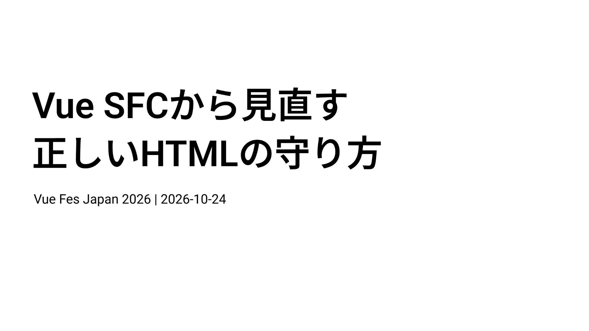

[日本語ページ](../ja/) / [English page](../en/)

## スライド

[スライド版ページ](https://records.yamanoku.net/vuefes-japan-2026/slide/)

---

## はじめに

みなさま、こんにちは。やまのくと申します。

一児の父で今月10月いっぱいまで会社員としてやっております。今年のVue Fes Japan 2026 ではコアスタッフとしても関わっております。

今年はHTMLにまつわるイベントとしてHTML Night in Tokyo や HTML Day 2026 in 東葛の主催もしておりました。

昨年のVue Fes Japan 2025では生成AIとアクセシビリティ改善について発表させてもらい、今年も登壇となります。

個人で作っているものについて1つ宣伝させてください。[Vue Fes Japan Speakers](https://vuefes-japan-speakers.yamanoku.net/)という2018年から今年までの歴代の登壇者まとめサイトを個人で運営しております。こちらはVue.jsで作られてCloudflareでホスティングしています。

自分のページを確認してみると、この四年間の間にパネルディスカッションも含めて六回も登壇させてもらっていました。年内でカンファレンス登壇については一旦止めようかなと思っているので、今年のVue Fesが最後の発表になるつもりです。これまで登壇の機会をいただき改めて感謝しております。

今回の発表ではタイトルにもあるように「HTML」を取り扱ったテーマで発表させていただきます。以前HTML5 カンファレンスというフロントエンドカンファレンスがあったのですが、それ以来であまりHTMLにまつわる発表をカンファレンスでは聴かなくなったと思っています。ですが池田さんの発表にもあったようにHTMLについては常にアップデートされてきており、今改めてHTMLそのものについてをVueのSFCと絡めて紹介できればと思い、このようなテーマにて応募させてもらいました。

HTMLは1991年に世の中に登場し、今年で35年になります。文書のためのマークアップとして広がり、そこから装飾するための要素が追加されていったり、フォームやインタラクティブな操作ができる要素が増えていきました。CSSとJavaScriptからの関心の分離も進んできていた中で、普段のフロントエンド開発で使われるUIライブラリの中ではそのHTMLを使って実装されています。Angular、SvelteらはHTMLの要素を使用しコンポーネント開発ができ、ReactやSolidではJSXでの式の中でHTMLのような表現を使っています。現在はマークダウンよりも表現力高く扱えるため、AIの出力結果としても使われています。そんなHTMLの仕様は [HTML Living Standard](https://html.spec.whatwg.org/) として、常に更新され続けています。

VueのSFCにはtemplateブロックにてHTMLを記述できる構文が備わっていますが、これは周知の事実だと思います。このときの見た目はHTMLですが、最終的にはJavaScriptへと変換されていきます。

```vue
<script setup>
  import { ref } from "vue";
  const count = ref(2026);
  const addYear = () => {
    count.value++;
  };
</script>

<template>
  <h1>Vue Fes Japan {{count}} へようこそ！</h1>
  <button type="button" class="btn" @click="addYear">+1</button>
</template>

<style scoped>
/* ... */
</style>
```

さて今回の本題にも含まれている「HTMLの正しさ」についてですが、Vue.jsを使った開発をするときに、どのように正しさを検証しているか、皆さんは説明できますでしょうか。今日の発表では、これを聴いた皆さんが、この問いに答えられるようになることを目指していきます。

発表の結論を先にお伝えしておくとこのような形になります。

- HTMLのパースエラー → **検出される**
- HTMLの要素組み合わせ → **開発時に警告**
- HTMLの具体的な使い方 → **関与しない**

VueのSFCにおけるtemplate内では、HTMLのパースが誤っているとエラーとして検出されます。HTMLの要素間の組み合わせに違いがあるときは、開発時に警告してきますが明確にコンパイルエラーにはなりません。そして具体的なHTML要素の使い方に関しては一切関与していません。

今回はVueコンパイラ側で見る限界と、その限界を補佐するためにどのように対処するかについてを紹介していきます。

今回のアジェンダになります。

1. 「正しいHTML」とは何か
2. コンパイラはどう解釈し、どこまで見るか
3. 静的解析でどう守るか

---

## 「正しいHTML」とは何か？

まずは、今回の発表タイトルにもある「正しいHTML」とは何か、についてを皆さんと揃えていきたいと思います。

正しいものと間違ったものの確認として、サイトの紹介文にも含まれている「日本最大級のフロントエンドカンファレンス Vue Fes Japan」という文章をHTMLでマークアップしてみます。

この文章を出すだけなら、まず段落として書くと思います。次に「日本最大級のフロントエンドカンファレンス」は大事な部分だと思うのでここを強調していきます。そこから「日本最大級の」を一番強く強調します。この要件が揃った中でどのようにマークアップするかを考えてみてください。

意図どおりに書くと、次のような形になります。

```html
<p>
  <em><strong>日本最大級の</strong>フロントエンドカンファレンス</em> Vue Fes Japan
</p>
```

このHTMLはブラウザ上ではこのように表示されます。

<figure>


<figcaption>意図どおりの入れ子は、DOMにもそのまま現れる</figcaption>
</figure>

そして最後にブラウザで描画されるHTMLは以下のような形で表示されます。

```html
<p>
  <em>
    <strong>日本最大級の</strong>
    フロントエンドカンファレンス
  </em>
  Vue Fes Japan
</p>
```

一方で、emとstrongの閉じタグの対応を誤るとどうなるでしょうか。このマークアップをした状態でブラウザ上で表示してみます。

```html
<p>
  <em><strong>日本最大級の</em>フロントエンドカンファレンス</strong> Vue Fes Japan
</p>
```

<figure>


<figcaption>誤りがあっても画面は出る。ただしHTMLは意図とずれる</figcaption>
</figure>

先ほどのと比較すると「フロントエンドカンファレンス」まで太字になっているように見えます。これが実際にはどのようにブラウザ上のHTMLとして表現しているかを見てみます。「日本最大級の」までは意図としてはあってそうですが、その後のフロントエンドカンファレンスまで最大級に強調されていることになっています。

```html
<p>
  <em>
    <strong>日本最大級の</strong>
  </em>
  <strong>フロントエンドカンファレンス</strong>
  Vue Fes Japan
</p>
```

このように結果的に表示されるHTMLは最初に期待したものとは違う形になります。

HTML構文はエラーとなってもブラウザ側は自己解釈してパースします。仕様は「表示できること」がすなわち「適合」とはなっておらず、ただただ誤りを整理しているだけです。こうした正しくないHTMLというのは文書構造・スタイルの適応・SSR時・アクセシビリティで問題が起こる可能性があります。

マークアップ自体には唯一の正解というものはありません。代わりにHTMLでは守らなければならない「ルール」は存在します。先ほど紹介したHTMLを正しくパースさせるのも、その1つです。そうしたルールを徹底できていることを、本発表では「HTMLの正しさ」を守れている、と定義したいと思います。

正しいHTMLであることには、次のようなメリットがあります。

まず一つにセマンティクスなコードを実現することで意図があるコードとなり、divやspanといった意味をもたないもので書くことよりも堅牢で保守的なコードに繋がります。

二つめにWebブラウザ上で表現されることで人やユーザーエージェントの双方が正しく解釈して扱えるものにもなります。

三つめにHTMLそのものがもつアクセシビリティの要件が使えるようになるためブラウザ上の中でのアクセシビリティを一定担保することができます。

最後にSSRにおけるハイドレーションミスマッチを事前に防ぎ、アプリケーションを正常に動作させることにも繋がります。

次に、正しさを守るためのルールを紹介します。

HTMLの正しさを守るために3つのルールが存在します。

1. **字句的ルール**
2. **語彙的ルール**
3. **意味論的ルール**

順番に紹介していきます。

### 字句的ルール

まずはじめに字句的ルールについて。これは開始タグと終了タグの対応、属性の書き方にまつわるルールです。違反するとパーサによってはエラーを出し、DOMツリーが正しく作れないことに繋がります。

```html
<!-- NG: 終了タグが対応していない / 属性値の書き方が崩れている -->
<div>
  <p>テキスト
</div>
```

HTMLの仕様をまとめるWHATWGでは、こうした構文をなぜ非適合にするかを [Syntax errors](https://html.spec.whatwg.org/dev/introduction.html#syntax-errors) の章で説明しています。

### 語彙的ルール

次に語彙的ルールです。使える要素・属性と、コンテンツモデルによる入れ子ルールです。こちらは字句的ルールよりも厄介なところで、パーサ上は問題とならないことがあるのですが、DOMとしては望ましくないものとなります。つまりタグの位置や使い方の対応は合っていても、要素間で入れられるものの内容が誤っていると壊れたDOMができます。たとえば `p` の中に `div` を置く、といった例です。

```html
<!-- NG: p の中にブロック要素は置けない -->
<p>
  <div>block</div>
</p>
```

仕様側では [Restrictions on content models and on attribute values](https://html.spec.whatwg.org/dev/introduction.html#restrictions-on-content-models-and-on-attribute-values) として整理されています。

### コンテンツモデル

コンテンツモデルは「どの要素の中に何を置けるか」を決める語彙的ルールの中核となります。たとえば `p` のコンテンツモデルは Phrasing content なので、`div` のような Flow 専用の要素は入れられないというルールがあります。語彙的ルールについてはMDNなどからそれぞれの要素がどのカテゴリに属しているか定義しているのでそこから確認できます。

コンテンツモデルの違反の一例を表にまとめました。

| 親 | 子要素 | なぜNGなのか |
| --- | --- | --- |
| `p` | `div`, `p`, `ul` | 段落の中にブロックを入れられない |
| `label` | `div`, `p` | ラベルのコンテンツモデル外 |
| `a` | `a` | リンクの入れ子は不可 |
| `ul` / `ol` | `div` | 基本的に `li` |

### 意味論的ルール

最後に意味論的ルールです。いわゆるセマンティクスと呼ばれている部分です。本来要素がもつ用途とは異なる使い方をしている場合は違反になります。HTMLの文法として正しい使い方をしていても、伝えたい意味が異なることがあります。たとえば、見た目のためだけに `h1` を使う、ボタンを `a` で作る、といった例です。

```html
<!-- NG: 見た目のためだけに見出しを使う -->
<h1 class="title-like">ただ大きい文字にしたいだけ</h1>

<!-- NG: ボタンを a で作る -->
<a href="#" onclick="submitForm()">送信</a>
```

ここはツールだけでは完全には検出できないため、人間によるチェックも必要となる部分です。意味論を扱うことは、HTMLの強みであるアクセシビリティを活かすことに直結します。

---

## コンパイラはどう解釈し、どこまで見るか

次に、Vue SFC内のtemplateの内部をVueコンパイラがどのように解釈しているか、仕組みから見ていきます。

改めて、VueでもHTMLはDSLとして活用されています。見た目はHTMLですが、最終的にはJavaScriptへと変換されます。

```vue
<script setup>
  import { ref } from "vue";
  const count = ref(2026);
  const addYear = () => {
    count.value++;
  };
</script>

<template>
  <h1>Vue Fes Japan {{count}} へようこそ！</h1>
  <button type="button" class="btn" @click="addYear">+1</button>
</template>
```

Vue SFCのコンパイルは次の3段階に分けられます。

1. **Parse** — SFCの内容を元にASTを作る
2. **Transform** — Vueディレクティブや最適化をASTに適用する
3. **Generate** — 最終的にJavaScriptに変換する

まずParse時点で壊れているHTMLの書き方を検知してエラーを出せます。ここが字句的ルールの守備範囲です。

### `<div />` はパース可能か

ここでパースにまつわるクイズです。`div` 要素の自己完結タグはパース可能でしょうか？

答えは、パース可能です。Vueでは自己完結タグが付いているものを `div` 要素の開始と終了タグのものとして解釈されます。Custom Elements や Vueコンポーネントも自己完結タグが可能であり、これは解釈されるASTに含まれる `isSelfClosing` の有無で判定しています。

- `<div v-text="Vue Fes Japan" />` は `<div>Vue Fes Japan</div>` とレンダリングされる
- `<div />Vue Fes Japan` は `<div></div>Vue Fes Japan` となる

ただしHTMLの仕様として、`div` の自己完結タグは有効ではありません。ここはVueのパーサーとHTMLの仕様とのズレとして理解しておくことが必要です。

Vue以外での自己完結タグに関する余談についても紹介します。Prettierのフォーマットでは必ず閉じタグが付くようになっています。近年見直しがされそうな雰囲気もありますが、ここは変更できないことは注意です。一方でBiomeのフォーマットではオプションで変えられるようになっています。デフォルトでは自己完結タグを付けないように変更されています（`--html-formatter-self-close-void-elements=<always|never>`）。Svelteにおいては Rich Harris 氏が自己完結タグの挙動を捉え違いていたことを反省し、修復するためのマイグレーションツール（`npx svelte-migrate self-closing-tags`）が作られました。ライブラリやフレームワークごとに慣習が分かれている、という部分についても覚えておくとよいと思います。

### コンテンツモデルは警告してくれる

では、Vueは字句的ルール以外何もしないのかというと、そうではありません。Vue 3.4以降、`compiler-dom` の `validateHtmlNesting` により、不正なネストが開発時に警告されます。

<figure>


<figcaption>開発時のネスト警告の例。ありがたいDXだが、警告を無視すればそのまま動いてしまう</figcaption>
</figure>

SSRにおけるハイドレーションミスマッチを防ぐ意図のあるありがたいDXです。ですが、これはあくまでも開発時の警告であり、明確なコンパイルエラーではありません。警告を無視すればそのまま動いてしまいます。

以上より、Vueコンパイラが見る範囲は次のとおりです。

| ルール | Vueコンパイラの対応 |
| --- | --- |
| 字句的 | 〇（自己完結タグについては独自の解釈） |
| 語彙的（要素の使い方） | △（開発時の警告のみ） |
| 意味論的 | ✕ |

字句的ルールは、自己完結タグの解釈を除いて、パースしてくれるような仕組みがあるという点では出来ていると思います。語彙的ルールは開発時の警告のみという点で完全にできているかというと微妙なライン。意味論的ルールに関するものはまったくない判定としています。そのため語彙的・意味論的なルールは別の仕組み、今回取り上げる静的解析の仕組みで対応する必要があります。

### なぜ静的解析が必要なのか

紹介に入る前に、なぜ静的解析という手段が必要なのかについてを触れていきます。

昨年の私の発表ではゼロショットでも一定アクセシブルなコードは書けると紹介しました。バイブコーディングでも大丈夫なのではないでしょうか。

こうした疑問に対する私の結論としては、決定論としての判断をAIエージェントに与えられるようにするために静的解析は必要だと思っています。

現在の開発において大半の人たちはAIエージェントを活用した開発をしていると思います。ただAIのみの判定は非決定論的です。賢くてもモデル依存となり、その確実性や再現性といったものは薄くなってしまいます。HTMLの構造的に正しいか、意図と矛盾していないかを静的解析で決定論的に証明し、その情報をもとに判断ができるようにすることで「正しさ」により確実性や再現性が出てくると思っています。

---

## 静的解析でどう守るか

というわけでコンパイラだけでは保てないHTMLの正しさを、静的解析のエコシステムたちでどこまで、どのように守れるかを紹介します。

### ESLint

最初に見ていくのはESLintです。VueのESLintといえば [eslint-plugin-vue](https://eslint.vuejs.org/) が有名です。

このプラグインでは [`vue/no-parsing-error`](https://eslint.vuejs.org/rules/no-parsing-error.html) で `<template>` 内の構文エラーを報告できます。HTML仕様における字句的な構文エラーを多く検知でき、essential 系プリセットにも含まれているルールです。自己完結タグに関するチェックのみは、デフォルトで無効になっています。これは字句的なルールですが、ランタイムを通さずにコードだけ見て気付くことができることで優位性があります。

しかしこのプラグインにおいて語彙的ルールを守れるものは確認できませんでした。代わりに意味論的に扱えるものとしてbutton要素のtype属性値を強制する [`vue/html-button-has-type`](https://eslint.vuejs.org/rules/html-button-has-type.html) などが唯一あげられそうです。

アクセシビリティという形から意味論を守れるのは [eslint-plugin-vuejs-accessibility](https://vue-a11y.github.io/eslint-plugin-vuejs-accessibility/) が挙げられます。たとえば [`form-control-has-label`](https://vue-a11y.github.io/eslint-plugin-vuejs-accessibility/rules/form-control-has-label.html) では、ラベルと入力側のコンポーネントを指定できます。

```json
{
  "rules": {
    "vuejs-accessibility/form-control-has-label": [
      "error",
      {
        "labelComponents": ["CustomLabel"],
        "controlComponents": ["CustomInput"]
      }
    ]
  }
}
```

### Biome

次に Biome です。リンター・フォーマッターがまとまったオールインツールです。さまざまな言語やライブラリに対応しており、Vueでも使用可能です。

`li` 要素を適切な親要素に使用しているかといった部分的な語彙的ルールのチェックができたり（[`noMisplacedListElements`](https://biomejs.dev/linter/rules/no-misplaced-list-elements/)）、重複した属性をチェックしたり（[`noDuplicateAttributes`](https://biomejs.dev/linter/rules/no-duplicate-attributes/)）、非推奨のHTML要素を使っていないか（[`noObsoleteTags`](https://biomejs.dev/linter/rules/no-obsolete-tags/)）、意味論寄りのチェック（[`useSemanticElements`](https://biomejs.dev/linter/rules/use-semantic-elements/)）もできます。

さらに Biome では、HTML拡張言語のサポートが進んでいます。v2.3.0以降、Vue / Svelte / Astro を標準で扱え、ファイル内の HTML / CSS / JavaScript をフォーマット・リントできます。まだ実験的なので、明示的に有効化する必要がありますが、一定使えるレベルに達していると思います。

### Oxc

オールツールチェインものとしてOxcも紹介しておきます。[OxLint](https://oxc.rs/) は Linterツールで、Vue固有のルールは強い一方、いまは `<template>` 内部のHTMLを深く見る機構はありません。[RFC: Embedded Framework Support for Oxlint (Language Plugins)](https://github.com/oxc-project/oxc/discussions/21936) が進むと、対応の見通しが見えてきそうなので今後に期待と言ったところです。

というわけでESLint や Biome / Oxc が得意なのは主に字句・構文寄り、あるいは語彙の一部です。コンテンツモデルや適合性までを厚く見る層が足りていませんでした。

### Markuplint

この足りていない部分を埋めるLinterとして挙げるのが [Markuplint](https://markuplint.dev/) です。Markuplintの長所は、Living Standardベースの幅広い検証ができることです。Vueにおいては `@markuplint/vue-parser` と `@markuplint/vue-spec` が用意されています。

[`permitted-contents`](https://markuplint.dev/docs/rules/permitted-contents) では、コンテンツモデルを仕様データから検証できます。`ul` の直下に `div` を置くと不正、`li` なら正しい、といった判定です。ここでようやく語彙的ルールの本格的なチェックが可能となりました。

```html
<!-- incorrect -->
<ul>
  <div>Not allowed DIV element</div>
</ul>

<!-- correct -->
<ul>
  <li>List item</li>
  <li>List item</li>
</ul>
```

Markuplintはその名の通りマークアップに対するLintができるものになります。意味論寄りのルールも多く含まれています。

[`no-pseudo-list`](https://markuplint.dev/ja/docs/rules/no-pseudo-list) は、ビュレット文字で箇条書きを擬似している箇所を止め、`ul` / `li` を使うよう求めます。

```html
<!-- incorrect -->
<div>
  •Apple<br />
  •Banana
</div>

<!-- correct -->
<ul>
  <li>Apple</li>
  <li>Banana</li>
</ul>
```

ほかにも [`no-consecutive-br`](https://markuplint.dev/ja/docs/rules/no-consecutive-br)（連続 br）というルールや、[`no-skipped-heading-level`](https://markuplint.dev/ja/docs/rules/no-skipped-heading-level)（見出しレベルの飛ばし厳禁）というルールがあります。

```html
<!-- incorrect: no-consecutive-br -->
<p>
  A...<br />
  <br />
  B...
</p>

<!-- correct -->
<p>A...</p>
<p>B...</p>
```

```html
<!-- incorrect: no-skipped-heading-level -->
<h1>Heading 1</h1>
<h3>Heading 3<!-- SKIPPED --></h3>
<h4>Heading 3</h4>

<!-- correct -->
<h1>Heading 1</h1>
<h2>Heading 2</h2>
<h3>Heading 3</h3>
```

Markuplintの優れた機能として [Pretenders](https://markuplint.dev/docs/guides/besides-html) というものがあります。これはVueコンポーネントを実際の描画結果のHTML要素に見立てるオプションです。たとえば `FileList` というVueコンポーネントを `ul`、`FileListItem` というVueコンポーネントを `li` のようにコンテンツモデルを評価できるようになります。Markuplintのv5からは experimental で自動的にコンポーネントスキャンができるため、手動でのリストアップをせずとも検知できるようになります。

```json
{
  "pretenders": {
    "scan": [
      {
        "files": "./src/components/**/*.vue"
      }
    ]
  }
}
```

Markuplintによって「コンテンツモデルをチェックする」と「意味論としてチェックする」ことができるようになりました。

### Vize

その流れの先に、新しく登場しているツールがあります。それが [Vize](https://vizejs.dev/) です。これはubugeeeiさん作・RustによるVueのオールツールチェインです。Vizeに含まれるLinterではHTML適合性を Vue固有ルール / アクセシビリティから分離して扱えます。

- Vue: https://vizejs.dev/rules/vue/index.html
- HTML: https://vizejs.dev/rules/html/index.html
- a11y: https://vizejs.dev/rules/accessibility/index.html

Markuplintにあったコンテンツモデルの検査も `vue/permitted-contents` のルールにて検査できます。

特にVizeのLinterで優れているものが `html/cross-component-nesting` です。単ファイルでは問題ないマークアップでも、コンポーネントと組み合わせることで間違ってしまう関係性を、ファイル横断で止められます。`vize lint --cross-file` でファイル横断チェックができます。

たとえば `App.vue` で `p` の中に `InfoCard` を置き、`InfoCard` のルートが `div` だと、各ファイル単体では合法でも、合成結果は実質 `p` の中に `div` となり不正です。

```vue
<!-- App.vue -->
<template>
  <p>Summary <InfoCard /></p>
</template>

<!-- InfoCard.vue -->
<template>
  <div class="card"><slot /></div>
</template>
```

Vizeはこの「合成後」の確認を標準でできることが優れている点だと思っています。

あわせてVizeはVueのコンパイラの代替もできます。`templateSyntax` というオプションを扱うことで自己完結タグがある場合にコンパイラ側にて警告するようにしており、モードの切り替えでエラーとしたり無視することもできるようになっているのもあります。

```js
import vize from "@vizejs/vite-plugin";

export default {
  plugins: [
    vize({
      templateSyntax: "standard",
    }),
  ],
};
```

このほかにもVizeはLintに限らない多機能なツールを兼ね揃えています。15:05からウェルネス×hacomonoトラックにてubugeeeiさんの発表もあるので気になる方は是非聞きに行ってみてください。

---

## おわりに

最後にこの発表のまとめです。

1. HTMLの正しさを保つためのルールを把握すること
2. Vueコンパイラがどう解釈し、どこまで見るかを理解すること
3. 静的解析で、コンパイラが見ない部分を補佐すること

静的解析ツールは各人の環境で合わせて必要なものを組み合わせていくのが良いと思います。

今回の発表を参考にして、Vue.jsで堅牢なマークアップとHTMLによるアクセシブルなアウトプットを実現していきましょう。

以上で発表を終わります。ご清聴いただきありがとうございました。

## 参考文献

- [HTML Standard](https://html.spec.whatwg.org/)
- [WHATWG: Non-conforming features](https://html.spec.whatwg.org/#non-conforming-features)
- [Vue: validateHtmlNesting](https://github.com/vuejs/core/blob/main/packages/compiler-dom/src/transforms/validateHtmlNesting.ts)
- [eslint-plugin-vue](https://eslint.vuejs.org/rules/)
- [eslint-plugin-vuejs-accessibility](https://vue-a11y.github.io/eslint-plugin-vuejs-accessibility/)
- [Biome](https://biomejs.dev/)
- [Oxlint | The JavaScript Oxidation Compiler](https://oxc.rs/docs/guide/usage/linter.html)
- [Markuplint](https://markuplint.dev/)
- [Vize](https://vizejs.dev/index.html)
