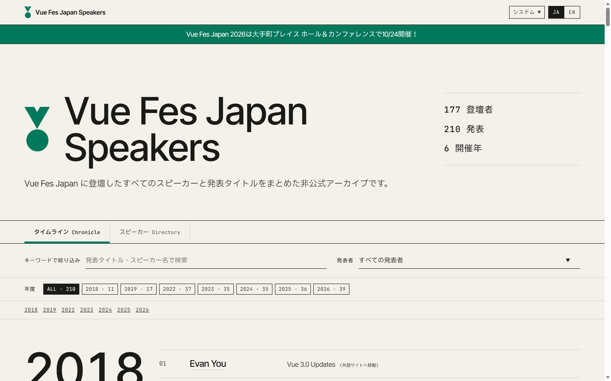
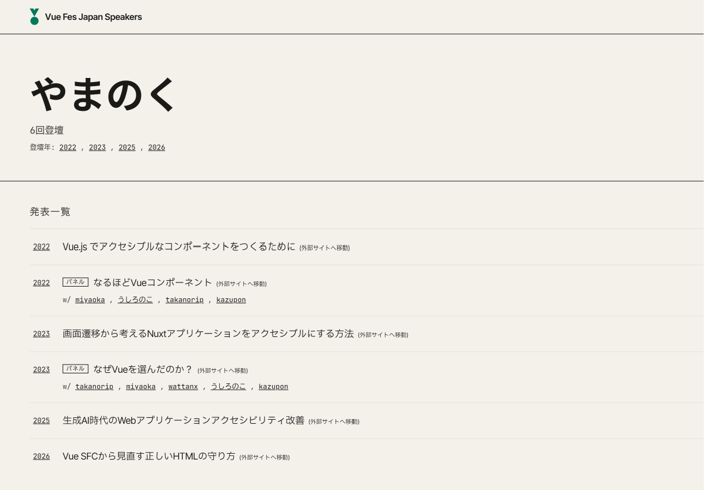
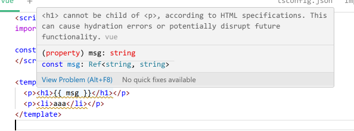

<h1 mt="24">Vue SFCから見直す<br>正しいHTMLの守り方</h1>

<div mt="5">
Vue Fes Japan 2026 | <time datetime="2026-10-24">2026-10-24</time>
</div>

<div mt="6">

[ドキュメントページ版（日本語）](https://records.yamanoku.net/vuefes-japan-2026/ja/) | [Document Page Version（English）](https://records.yamanoku.net/vuefes-japan-2026/en/)

</div>

<div class="absolute bottom-10">
  <span class="text-6 font-700">
    やまのく（yamanoku）
  </span>
</div>

---

## 発表者：やまのく


- 一児の父、会社員（～2026/10）
- Vue Fes Japan 2026 コアスタッフ
- HTML Night in Tokyo、HTML Day 2026 in 東葛 主催

<!--
みなさま、こんにちは。やまのくと申します。

一児の父で今月10月いっぱいまで会社員としてやっております。今年のVue Fes Japan 2026 ではコアスタッフとしても関わっております。

今年はHTMLにまつわるイベントとしてHTML Night in Tokyo や HTML Day 2026 in 東葛の主催もしておりました。

昨年のVue Fes Japan 2025では生成AIとアクセシビリティ改善について発表させてもらい、今年も登壇となります。
-->

---
layout: center
---



<!--
Vue Fes Japan Speakersという2018年から今年までの歴代の登壇者まとめページも個人で運営しております。

こちらはVue.jsで作られてCloudflareでホスティングしております。
-->

---
layout: center
---



<!--
自分のページを確認してみると、この四年間の間にパネルディスカッションも含めて六回も登壇させてもらっていました。

年内でカンファレンス登壇については一旦止めようかなと思っているので、今年のVue Fesが最後の発表になるつもりです。

改めて登壇の機会をいただき感謝しております。
-->

---
layout: center
---

<h1 class="html">HTML</h1>

<!--
今回の発表ではタイトルにもあるように「HTML」を取り扱ったテーマで発表させていただきます。

以前HTML5 カンファレンスというフロントエンドカンファレンスがあったのですが、それ以来であまりHTMLにまつわる発表をカンファレンスでは聴かなくなったと思っています。

ですが池田さんの発表にもあったようにHTMLについては常にアップデートされてきており、今改めてHTMLそのものについてをVueのSFCと絡めて紹介できればと思い、このようなテーマにて応募させてもらいました。
-->

---

## HTMLの登場から35年

- 1991年に世の中に登場し、文書のためのマークアップとして広がった
- 装飾性のあるものやWebアプリのUIとして活用されるまで進化
- マークダウンよりも表現力高く扱うことができるためAIの出力に活用
- 仕様はLiving Standardとして今も更新され続けている

<!--
HTMLは1991年に世の中に登場し、今年で35年になります。

文書のためのマークアップとして広がり、装飾性のあるページやWebアプリのUIとして活用されるまで進化してきました。

マークダウンよりも表現力高く扱えるため、AIの出力にも使われています。

HTMLの仕様は HTML Living Standard として、今も更新され続けています。
-->

---


<small><a href="https://www.dropbox.com/scl/fi/4al6p7za54z9k3zidqps7/HTML.paper?rlkey=mo5qbfgq60pct57l743jqtksa&dl=0" target="_blank">HTMLという地層の堆積</a> / yuhei</small>

<!--
HTMLの初期は見出し・段落・リンクなど文書構造を表す言語でした。

そこから装飾するための要素が追加されていったり、フォームやインタラクティブな操作ができる要素が増えていきました。

CSSとJavaScriptからの関心の分離も進んできていた中で、普段のフロントエンド開発で使われるUIライブラリの中ではそのHTMLを使って実装されています。

Angular、SvelteらはHTMLの要素を使用しコンポーネント開発ができ、ReactやSolidではJSXでの式の中でHTMLのような表現を使っています。
-->

---

```vue
<script setup>
  import { ref } from "vue";
  const count = ref(2026);
  const addYear = () => {
    count.value++;
  };
</script>

<template>
  <h1>Vue Fes Japan {{count}} へようこそ！</h1>
  <button type="button" class="btn" @click="addYear">+1</button>
</template>
```

<!--
VueのSFCにはtemplateブロックにてHTMLを記述できる構文が備わっていますが、これは周知の事実だと思います。

このときの見た目はHTMLですが、最終的にはJavaScriptへと変換されていきます。
-->

---
layout: center
---

# Vueで「HTMLの正しさ」は<br>どう検証できる？

<!--
今回の本題にも含まれている「HTMLの正しさ」についてですが、Vue.jsを使った開発をするときに、どのように正しさを検証しているか、皆さんは説明できますでしょうか。

今日の発表では、この問いに答えられるようになることを目指します。
-->

---

## Vueコンパイラが見ているもの・見ていないもの

- HTMLのパースエラー→ **検出される**
- HTMLの要素組み合わせ → **開発時に警告**
- HTMLの具体的な使い方 → **関与しない**

<!--
今回の発表の結論を先にお伝えしておくとこのような形になります。

VueのSFCにおけるtemplate内では、HTMLのパースが誤っているとエラーとして検出されます。

HTMLの要素間の組み合わせに違いがあるときは、開発時に警告してきますが明確にコンパイルエラーにはなりません。

そして具体的なHTML要素の使い方に関しては一切関与していません。

今回はVueコンパイラ側で見る限界と、その限界を補佐するためにどのような仕組みで対処するかについてを紹介していきます。
-->

---

# アジェンダ

1. 「正しいHTML」とは何か
2. コンパイラはどう解釈し、どこまで見るか
3. 静的解析でどう守るか

<!--
今日は以下の三つに絞って紹介します。

1. 「正しいHTML」とは何か
2. コンパイラはどう解釈し、どこまで見るか
3. 静的解析でどう守るか
-->

---
layout: section
---

# 1.「正しいHTML」とは何か

<!--

まずは、今回の発表タイトルにもある「正しいHTML」とは何か、についてを皆さんと揃えていきたいと思います。

-->

---
layout: center
---

<div class="markup-sample"><mark>「日本最大級のフロントエンドカンファレンス Vue Fes Japan」</mark><br>をマークアップ</div>

<v-clicks>

- 紹介文として段落にしたい
- 「日本最大級のフロントエンドカンファレンス」を強調
- 「日本最大級の」を一番強く強調したい

</v-clicks>

<!--
HTMLの例としてサイトの紹介文にも含まれている「日本最大級のフロントエンドカンファレンス Vue Fes Japan」を取り上げてみます。

この文章を出すだけなら、まず段落として書くと思います。

次に「日本最大級のフロントエンドカンファレンス」は大事な部分だと思うのでここを強調していきます。

そこから「日本最大級の」を一番強く強調します。

この要件が揃った中でどのようにマークアップするかを考えてみてください。
-->

---
layout: center
---

```html
<p>
  <em><strong>日本最大級の</strong>フロントエンドカンファレンス</em> Vue Fes Japan
</p>
```

<v-click>


</v-click>

<v-click>

```html
<p>
  <em>
    <strong>日本最大級の</strong>
    フロントエンドカンファレンス
  </em>
  Vue Fes Japan
</p>
```

</v-click>

<!--
意図どおりに書くと、次のような形になります。

このHTMLはブラウザ上ではこのように表示されます。

そして最後にブラウザで描画されるHTMLは以下のような形で表示されます。
-->

---
layout: center
---

```html
<p>
  <em><strong>日本最大級の</em>フロントエンドカンファレンス</strong> Vue Fes Japan
</p>
```

<v-click>


</v-click>

<v-click>

```html
<p>
  <em>
    <strong>日本最大級の</strong>
  </em>
  <strong>フロントエンドカンファレンス</strong>
  Vue Fes Japan
</p>
```

</v-click>

<!--
一方で、emとstrongの閉じタグの対応を誤るとどうなるでしょうか。このマークアップをした状態でブラウザ上で表示してみます。

先ほどのと比較すると「フロントエンドカンファレンス」まで太字になっているように見えます。

これが実際にはどのようにブラウザ上のHTMLとして表現しているかを見てみます。
「日本最大級の」までは意図としてはあってそうですが、その後のフロントエンドカンファレンスまで最大級に強調されていることになっています。

このようにブラウザはエラーとはならず、結果的に表示されるHTMLは最初に期待したものとは違う形になり得ます。
-->

---

## ブラウザは誤りを「直す」

- HTML構文はエラーとなってもブラウザ側は自己解釈してパースする
- 仕様は「表示できる＝適合」とはせず、誤りを整理している
- 文書構造・スタイル・SSR・アクセシビリティで問題が起こる可能性がある

<!--
HTML構文はエラーとなってもブラウザ側は自己解釈してパースします。

仕様は「表示できること」がすなわち「適合」とはなっておらず、ただただ誤りを整理しているだけです。

こうした正しくないHTMLというのは文書構造・スタイル・SSR・アクセシビリティで問題が起こる可能性があります。
-->

---

## HTMLには「ルール」がある

- マークアップ自体には唯一の正解というものはない
- 代わりにHTMLでは守らなければならない「ルール」は存在する
  - 正しくパースさせる、もその１つ
- ルールを徹底できていることを「HTMLの正しさ」と定義する

<!--
マークアップ自体には唯一の正解というものはありません。

代わりにHTMLでは守らなければならない「ルール」は存在します。正しくパースさせるのも、その1つです。

それらのルールを徹底できていることを、本発表では「HTMLの正しさ」と定義したいと思います。
-->

---

## HTMLが正しいことのメリット

- 堅牢で保守的なコードで書ける
- 人やユーザーエージェント双方が扱える
- アクセシビリティを守れる
- ハイドレーションミスマッチを事前に防ぐ

<!--
HTMLが正しいことには、次のようなメリットがあります。

まず一つにセマンティクスなコードを実現することで意図があるコードとなり、divやspanといった意味をもたないもので書くことよりも堅牢で保守的なコードに繋がります。

二つめにWebブラウザ上で表現されることで人やユーザーエージェントの双方が正しく解釈して扱えるものにもなります。

三つめにHTMLそのものがもつアクセシビリティの要件が使えるようになるためブラウザ上の中でのアクセシビリティを一定担保することができます。

最後にSSRにおけるハイドレーションミスマッチを事前に防ぎ、アプリケーションを正常に動作させることにも繋がります。

次に、正しさを守るためのルールを紹介します。
-->

---

## 正しさの3つのルール

1. **字句的ルール**
2. **語彙的ルール**
3. **意味論的ルール**

<!--
HTMLの正しさを守るために３つのルールが存在します。

１つ目が字句的ルール。

２つ目が語彙的ルール。

３つ目が意味論的ルールになります。

順番に紹介していきます。
-->

---

## 字句的ルール

```html
<!-- NG: 終了タグが対応していない / 属性値の書き方が崩れている -->
<div>
  <p>テキスト
</div>
```
<hr class="mt-8 mb-8" />

- 開始タグと終了タグの対応、属性の書き方
- 違反するとパーサがエラーを出し、DOMツリーが正しく作れない


<small> WHATWG: [Syntax errors](https://html.spec.whatwg.org/dev/introduction.html#syntax-errors) </small>

<!--
まずはじめに字句的ルールについて。

これは開始タグと終了タグの対応、属性の書き方にまつわるルールです。

違反するとパーサによってはエラーを出し、DOMツリーが正しく作れないことに繋がります。

HTMLの仕様をまとめるWHATWGでは、こうした構文をなぜ非適合にするかを Syntax errors で説明しています。

不正な構文が直感に反するDOMを生む、ストリーミングと相性が悪い、著者が仕様を誤解しやすい、といった理由です。

仕様が「止める理由」を言語化しているので、後述するコンパイラやリンターにて機械的にチェックするようにしています。
-->

---

## 語彙的ルール

```html
<!-- NG: p の中にブロック要素は置けない -->
<p>
  <div>block</div>
</p>
```

<hr class="mt-8 mb-8" />

- **コンテンツモデル（content model）**
- どの要素の中に何を置けるかの中核的なルール
- 違反してもパーサは止まらず、望ましくないDOMになる


<small>

WHATWG: [Restrictions on content models and on attribute values](https://html.spec.whatwg.org/dev/introduction.html#restrictions-on-content-models-and-on-attribute-values)

</small>

<!--
次に語彙的ルールです。

使える要素・属性と、コンテンツモデルによる入れ子ルールです。

こちらは字句的ルールよりも厄介なところで、パーサ上は問題とならないことがあるのですが、DOMとしては望ましくないものとなります。

つまりタグの位置や使い方の対応は合っていても、要素間で入れられるものの内容が誤っていると壊れたDOMができます。

たとえば p の中に div を置く、といった例です。
-->

---

## コンテンツモデル

<ContentVenn />

<!--
コンテンツモデルは「どの要素の中に何を置けるか」を決める語彙的ルールの中核です。

仕様では Kinds of content として、各要素をゼロ以上のカテゴリに分けています。

たとえば p のコンテンツモデルは Phrasing content なので、div のような Flow 専用の要素は入れられません。

語彙的ルールについてはそれぞれの要素がどのカテゴリに属しているか定義しているのでそこから確認できます。
-->

---

## 違反するコンテンツモデル例

| 親 | 子要素 | なぜNGなのか |
| --- | --- | --- |
| `p` | `div`, `p`, `ul` | 段落の中にブロックを入れられない |
| `label` | `div`, `p` | ラベルのコンテンツモデル外 |
| `a` | `a` | リンクの入れ子は不可 |
| `ul` / `ol` | `div` | 基本的に `li` |

<!--
コンテンツモデルの違反の一例を表にまとめました。

p の中に div や p、ul。

label の中に div や p。

a の中に a。

ul や ol の直接の子に div、といったものになります。
-->

---

## 意味論的ルール

```html
<!-- NG: 見た目のためだけに見出しを使う -->
<h1 class="title-like">ただ大きい文字にしたいだけ</h1>

<!-- NG: ボタンを a で作る -->
<a href="#" onclick="submitForm()">送信</a>
```

<hr class="mt-8 mb-8" />

- 「セマンティクス」と呼ばれている部分
- 本来要素がもつ用途とは異なる使い方をしている場合は違反
- アクセシビリティの担保に必要

<!--
最後に意味論的ルールです。いわゆるセマンティクスと呼ばれている部分です。

本来要素がもつ用途とは異なる使い方をしている場合は違反になります。

HTMLの文法として正しい使い方をしていても伝えたい意味が異なることがあります。

たとえば、見た目のためだけに h1 を使う、ボタンを a で作る、といった例です。

ツールだけでは完全には検出できないため、人間によるチェックも必要となる部分です。

意味論は、HTMLの強みであるアクセシビリティに直結します。
-->

---
layout: section
---

# 2. コンパイラはどう解釈し、<br>どこまで見るか

<!--
次に、Vue SFC内のtemplateの内部をVueコンパイラがどのように解釈しているか、仕組みから見ていきます。
-->

---

## VueでもDSLとして活用されている

```vue
<script setup>
  import { ref } from "vue";
  const count = ref(2026);
  const addYear = () => {
    count.value++;
  };
</script>

<template>
  <h1>Vue Fes Japan {{count}} へようこそ！</h1>
  <button type="button" class="btn" @click="addYear">+1</button>
</template>
```

<!--
改めて、VueでもHTMLはDSLとして活用されています。見た目はHTMLですが、最終的には仮想DOM生成の関数へと変換されます。
-->

---

## コンパイルの三段階

1. **Parse**
    - SFCの内容を元にASTを作る
1. **Transform**
    - Vueディレクティブや最適化をASTに適用する
1. **Generate**
    - 最終的にJavaScriptに変換する

<v-click>

<div mt="10">Parse時点で壊れているHTMLの書き方を検知してエラーを出す（字句的ルール）</div>

</v-click>

<!--
Vue SFCのコンパイルは次の3段階に分けられます。

1. Parse — SFCの内容を元にASTを作る
2. Transform — Vueディレクティブや最適化をASTに適用する
3. Generate — 最終的にJavaScriptに変換する

まずParse時点で壊れているHTMLの書き方を検知してエラーを出せます。ここが字句的ルールの守備範囲です。
-->

---
layout: center
---

# Q. `<div />` はパース可能か

<!--
ここでパースにまつわるクイズです。

div 要素の自己完結タグはパース可能でしょうか？
-->

---

## A. パース可能

- Vueでは`<div></div>`として解釈される
- ASTに含まれる`isSelfClosing`の有無で判定している
- `<div v-text="Vue Fes Japan" />` = `<div>Vue Fes Japan</div>`
- `<div />Vue Fes Japan` は `<div></div>Vue Fes Japan` となる
- Custom Elements、Vueコンポーネントも自己完結タグが可能

<v-click>
  <div mt="12">
    <p text="8" font="bold">ただしHTMLの仕様として<code>&lt;div /&gt;</code>は有効ではない</p>
  </div>
</v-click>

<!--
答えは、パース可能です。Vueでは自己完結タグが付いているものをdiv要素の開始と終了タグのものとして解釈されます。

Custom Elements や Vueコンポーネントも自己完結タグが可能であり、これは解釈されるASTに含まれる isSelfClosing の有無で判定しています。

v-text を付けた自己完結タグは、中身が入った div としてレンダリングされます。

後ろにテキストを置いた場合は、空の div のあとにテキストが続きます。

ただしHTMLの仕様として、div の自己完結タグは有効ではありません。ここはVueのパーサーとHTMLの仕様とのズレとして理解しておくことが必要です。
-->

---

## 自己完結タグにまつわる余談

- Prettierのフォーマットでは必ず閉じタグが付くようになっている
- Biomeはオプションで変えられるようにしている
  - `--html-formatter-self-close-void-elements=<always|never>`
- SvelteはRich Harris氏が見直してマイグレーションツールが作成される
  - `npx svelte-migrate self-closing-tags`

<!--
Vue以外での自己完結タグに関する余談についても紹介します。

Prettierのフォーマットでは必ず閉じタグが付くようになっています。近年見直しがされそうな雰囲気もありますが、ここは変更できないことは注意です。

一方でBiomeのフォーマットではオプションで変えられるようになっています。デフォルトでは自己完結タグを付けないように変更されています。

SvelteにおいてはRich Harris氏が自己完結タグの挙動を捉え違いていたことを反省し、修復するためのマイグレーションツールが作られました。

ライブラリやフレームワークごとに慣習が分かれている、という部分についても覚えておくとよいと思います。
-->

---

## コンテンツモデルは警告してくれる



- `compiler-dom` の `validateHtmlNesting` (Vue 3.4)
- **開発時の警告**で、厳密にはコンパイルエラーではない
  - SSRにおけるハイドレーションミスマッチを防ぐ意図

<!--
では、Vueは字句的ルール以外何もしないのかというと、そうではありません。

Vue 3.4以降、compiler-dom の validateHtmlNesting により、不正なネストが開発時に警告されます。

SSRにおけるハイドレーションミスマッチを防ぐ意図のあるありがたいDXですが注意点があります。

これはあくまでも開発時の警告であり、明確なコンパイルエラーではありません。警告を無視すればそのまま動いてしまいます。
-->

---

## Vueコンパイラが見る範囲

| ルール | Vueコンパイラの対応 |
| --- | --- |
| 字句的 | 〇 |
| 語彙的（要素の使い方） | △（開発時の警告のみ） |
| 意味論的 | ✕ |

<v-click>
  <div mt="12">
    <p text="8" font="bold">語彙的・意味論的なルールは静的解析でチェックする</p>
  </div>
</v-click>

<!--
以上より、Vueコンパイラが見る範囲は次のとおりです。

字句的ルールはパースしてくれるような仕組みがあるという点では出来ていると思います。

語彙的ルールは開発時の警告のみという点で完全にできているかというと微妙なライン。

意味論的ルールに関するものはまったくないのでバツと判定しています。

そのため語彙的・意味論的なルールは別の仕組み、今回取り上げる静的解析の仕組みで対応する必要があります。
-->

---
layout: section
---

# 3. 静的解析でどう守るか

<!--
最後のパートです。

コンパイラだけでは保てないHTMLの正しさを、ESLint、Biome、Oxc、Markuplint、Vizeといった静的解析エコシステムで、いまどのように守れるかを紹介します。
-->

---

## なぜ静的解析が必要なのか

<v-click>

決定論としての判断をAIエージェントに与えられるようにするため

</v-click>

<v-click>

- AIのみの判定は非決定論的
  - 賢くてもモデル依存となり確実性は薄い
- 構造的に正しいか、型安全か、内部で矛盾していないかを解析させる

</v-click>

<!--
そもそも、なぜ静的解析という手段が必要なのか。

私なりの結論としては、決定論としての判断をAIエージェントに与えられるようにするためです。

現在の開発において大半の人たちはAIエージェントを活用した開発をしていると思います。

ただAIのみの判定は非決定論的です。

賢くてもモデル依存となり、確実性は薄くなってしまいます。

HTMLの構造的に正しいか、型安全か、内部で矛盾していないかを静的解析で決定論的に証明する、というのが求めたいところです。
-->

---

## ESLint - eslint-plugin-vue

- [`vue/no-parsing-error`](https://eslint.vuejs.org/rules/no-parsing-error.html) で`<template>` 内の構文エラーを報告できる
  - WHATWG HTMLの**字句的**な構文エラーを多く検知できる
  - ただし自己完結タグに関するチェックのみはデフォルトで無効になっている
- 語彙的ルールを守れるものは確認できず
- [`vue/html-button-has-type`](https://eslint.vuejs.org/rules/html-button-has-type.html) が意味論的に扱える

<!--
最初に見ていくのはESLintです。

VueのESLintといえばeslint-plugin-vueが有名です。

このプラグインでは vue/no-parsing-error で template 内の構文エラーを報告できます。

HTML仕様における字句的な構文エラーを多く検知でき、essential 系プリセットにも含まれているルールです。自己完結タグに関するチェックのみは、デフォルトで無効になっています。

これは字句的なルールですが、ランタイムを通さずにコードだけ見て気付くことができることで優位性があります。

しかしこのプラグインにおいて語彙的ルールを守れるものは確認できませんでした。

代わりに意味論的に扱えるものとしてbutton要素のtype属性値を強制する vue/html-button-has-type などが唯一あげられそうです。
-->

---

## ESLint - 意味論の補助と限界

- [eslint-plugin-vuejs-accessibility](https://vue-a11y.github.io/eslint-plugin-vuejs-accessibility/) で a11y から意味論を守れる
  - 例: [`form-control-has-label`](https://vue-a11y.github.io/eslint-plugin-vuejs-accessibility/rules/form-control-has-label.html)

```json
{
  "rules": {
    "vuejs-accessibility/form-control-has-label": [
      "error",
      {
        "labelComponents": ["CustomLabel"],
        "controlComponents": ["CustomInput"]
      }
    ]
  }
}
```

<!--
アクセシビリティという形から意味論を守れるのが eslint-plugin-vuejs-accessibility です。

たとえば form-control-has-label では、ラベルと入力側のコンポーネントを指定できます。
-->

---

## Biome

- リンター・フォーマッターがまとまったオールインツール
- [`noMisplacedListElements`](https://biomejs.dev/linter/rules/no-misplaced-list-elements/) は語彙的チェック
- 部分的な意味論的なチェックもできる
  - [`noDuplicateAttributes`](https://biomejs.dev/linter/rules/no-duplicate-attributes/)
  - [`noObsoleteTags`](https://biomejs.dev/linter/rules/no-obsolete-tags/)
  - [`useSemanticElements`](https://biomejs.dev/linter/rules/use-semantic-elements/)
- Vueなどの拡張言語のサポートは進んでおり、一定使えるレベルまで来ている

<!--
次に Biome です。

リンター・フォーマッターがまとまったオールインツールとして Biome があります。さまざまな言語やライブラリに対応しており、Vueでも使用可能です。

li要素を適切な親要素に使用しているかといった部分的な語彙的ルールのチェックができたり、重複した属性をチェックしたり、非推奨のHTML要素を使っていないか、意味論寄りのチェックもできます。

さらに Biome では、HTML拡張言語のサポートが進んでいます。v2.3.0以降、Vue / Svelte / Astro を標準で扱え、ファイル内の HTML / CSS / JavaScript をフォーマット・リントできます。フルサポートはまだ実験的なので、明示的に有効化する必要がありますが、一定使えるレベルに達していると思います。
-->

---

## Oxc

- **OxLint**: Linterツール。Vueは固有のルールチェックが主
- 現時点では`<template>`の内部をチェックする機構はない
- [RFC: Embedded Framework Support for Oxlint (Language Plugins)](https://github.com/oxc-project/oxc/discussions/21936)
  - このRFCが進めば対応されそう？

<!--
オールツールチェインものとしてOxcも紹介しておきます。

OxcにおけるLinterはOxLintです。Vue固有のルールは強い一方、いまは template 内部のHTMLを深く見る機構はありません。

Embedded Framework Support の RFC が進むと、対応の見通しが見えてきそうなので今後に期待と言ったところです。
-->

---

## Markuplint

- HTML Living Standard ベースの**適合性検証**ができる
- `@markuplint/vue-parser` / `@markuplint/vue-spec` で `.vue` を扱える
- コンパイラが見ない「要素の使い方」の中核を埋められる

<!--
ESLint や Biome / Oxc が得意なのは主に字句・構文寄り、あるいは語彙の一部です。コンテンツモデルや適合性までを厚く見る層が足りていませんでした。

その隙間を埋めるのが Markuplint です。

Markuplintの長所は、Living Standardベースの幅広い検証ができることです。Vueにおいては vue-parser と vue-spec が用意されています。
-->

---

## Markuplint - parse-error

HTML Living Standardにおけるトークナイズやツリー構築時の非致命的なパースエラーを検知

```json
{
  "parserOptions": {
    "parseError": {
      "duplicate-attribute": "error",
      "nested-comment": "warning"
    }
  }
}
```

<!--
parse-error では、HTML Living Standardにおけるトークナイズやツリー構築時の非致命的なパースエラーを検知できます。重複属性を error にする、ネストしたコメントを warning にする、といった設定ができます。
-->

---

## Markuplint - `permitted-contents`

コンテンツモデルを仕様データから検証できる

```html
<!-- incorrect -->
<ul>
  <div>Not allowed DIV element</div>
</ul>

<!-- correct -->
<ul>
  <li>List item</li>
  <li>List item</li>
</ul>
```

<!--
permitted-contents では、コンテンツモデルを仕様データから検証できます。ul の直下に div を置くと不正、li なら正しい、といった判定です。

ここでようやく語彙的ルールの本格的なチェックが可能となりました。
-->

---

## Markuplint - 意味論のチェック

```html
<!-- incorrect -->
<div>
  •Apple<br />
  •Banana
</div>

<!-- correct -->
<ul>
  <li>Apple</li>
  <li>Banana</li>
</ul>
```

<small>

https://markuplint.dev/docs/rules/no-pseudo-list

</small>

<!--
Markuplintはその名の通りマークアップに対するLintができるものになります。意味論寄りのルールも多く含まれています。

no-pseudo-list は、ビュレット文字で箇条書きを擬似している箇所を止め、ul / li を使うよう求めます。

ほかにも no-consecutive-br（連続 br）や no-skipped-heading-level（見出しレベルの飛ばし）などがあります。
-->

---

## Markuplint - Pretenders

- コンポーネントを描画結果の**HTML要素に見立てるオプション**
  - `FileList` → `ul`、`FileListItem` → `li` のようにコンテンツモデルを評価できる
- v5からexperimentalで自動スキャンも設定可能

```json
{
  "pretenders": {
    "scan": [
      {
        "files": "./src/components/**/*.vue"
      }
    ]
  }
}
```

<!--
Markuplintの優れた機能として Pretenders というものがあります。これはコンポーネントを実際の描画結果のHTML要素に見立てるオプションです。

たとえば FileList を ul、FileListItem を li のようにコンテンツモデルを評価できるようになります。これによりVueコンポーネントにもHTMLチェックができるようになります。

v5からは experimental で自動スキャンも設定可能です。

Markuplintによって「コンテンツモデルをチェックする」と「意味論としてチェックする」ことができるようになりました。
-->

---

## Vize

- ubugeeeiさん作・RustによるVueのオールツールチェイン
- HTML適合性を Vue固有ルール / アクセシビリティから分離して扱える
  - Vue: https://vizejs.dev/rules/vue/index.html
  - HTML: https://vizejs.dev/rules/html/index.html
  - a11y: https://vizejs.dev/rules/accessibility/index.html

<!--
その流れの先に、新しく登場しているツールがあります。それが Vize です。

これはubugeeeiさん作・RustによるVueのオールツールチェインで、HTML適合性を Vue固有ルール / アクセシビリティから分離して扱えます。
-->

---

## Vize - クロスコンポーネントネスト検査

- `html/cross-component-nesting`で、合成後に初めて不正になるネストの検知が可能
  - `vize lint --cross-file`でファイル横断チェックができる

```vue
<!-- App.vue -->
<template>
  <p>Summary <InfoCard /></p>
</template>

<!-- InfoCard.vue -->
<template>
  <div class="card"><slot /></div>
</template>
```

<!--
特に重要なのが html/cross-component-nesting です。単ファイルでは合法でも、コンポーネント合成で壊れるネストを、ファイル横断で止められます。vize lint --cross-file でファイル横断チェックができます。

たとえば App.vue で p の中に InfoCard を置き、InfoCard のルートが div だと、各ファイル単体では合法でも、合成結果は実質 p の中に div となり不正です。

Vizeはこの「合成後」の確認が自動でできるところが優れている点だと思っています。
-->

---

## Vize - templateSyntax

- コンパイラ側は自己完結タグがある場合に警告するようにしている
  - モードの切り替えでエラーとしたり無視することもできる

```js
import vize from "@vizejs/vite-plugin";

export default {
  plugins: [
    vize({
      templateSyntax: "standard",
    }),
  ],
};
```

<!--
あわせて templateSyntax もあります。コンパイラ側は自己完結タグがある場合に警告するようにしており、モードの切り替えでエラーとしたり無視することもできます。

このほかにもVizeはLintに限らない多機能なツールを兼ね揃えています。
15:05からウェルネス×hacomonoトラックにてubugeeeiさんの発表もあるので気になる方は是非聞きに行ってみてください。
-->

---

## まとめ：Vueで正しいHTMLと向き合うために

1. 「正しさ」の物差し（字句／語彙／意味論）を把握する
1. コンパイラの解釈と守備範囲を理解する
1. 静的解析で、コンパイラが見ない穴を設計する

<!--
まとめです。

１つはHTMLの正しさを保つためのルールを把握すること。

２つめはVueコンパイラがどう解釈し、どこまで見るかを理解すること。

３つめは静的解析で、コンパイラだけでは保てない正しさを設計すること。

静的解析ツールは各人の環境で合わせて必要なものを組み合わせていくのが良いと思います。

今回の発表を参考にして、Vue.jsで堅牢なマークアップとHTMLによるアクセシブルなアウトプットを実現していきましょう。

以上で発表を終わります。ご清聴いただきありがとうございました。
-->

---

## 参考文献

- [HTML Standard](https://html.spec.whatwg.org/)
- [WHATWG: Non-conforming features](https://html.spec.whatwg.org/#non-conforming-features)
- [Vue: validateHtmlNesting](https://github.com/vuejs/core/blob/main/packages/compiler-dom/src/transforms/validateHtmlNesting.ts)
- [eslint-plugin-vue](https://eslint.vuejs.org/rules/)
- [eslint-plugin-vuejs-accessibility](https://vue-a11y.github.io/eslint-plugin-vuejs-accessibility/)
- [Biome](https://biomejs.dev/)
- [Oxlint | The JavaScript Oxidation Compiler](https://oxc.rs/docs/guide/usage/linter.html)
- [Markuplint](https://markuplint.dev/)
- [Vize](https://vizejs.dev/index.html)
